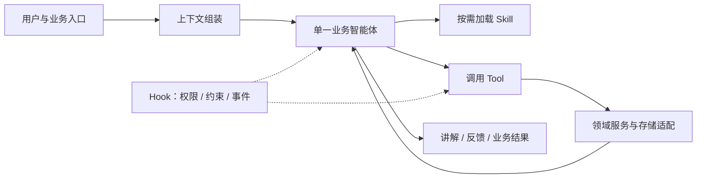

# 沐斯 Agent Framework

**一个以单智能体为核心、通过 Tool、Skill 和 Hook 扩展业务的通用智能体框架。**

作者：[Nights0907](https://github.com/Nights0907)

本项目希望回答一个实际问题：如何把一个会调用大模型的程序，搭建成能够使用工具、管理上下文、保留学习记忆、压缩会话并可靠保存业务结果的智能体系统？

项目目前以“沐斯 AI 数字人教师”作为可运行的业务示例。数学解题、引导教学、学习档案、复习提醒与个性化出题，都是同一智能体围绕不同上下文使用技能与工具的实例。框架的目标不限于教育：其他业务可以沿用运行时，替换领域上下文、Tool、Skill、Hook和存储适配。

> 这是持续演进的研究与工程实践项目。教育领域的演示功能不代表生产级教学质量保证；通用出题的模型复核也不是数学形式证明。

## 你能从项目中了解什么

| 主题 | 在项目中可以看到的实践 |
| --- | --- |
| 智能体 | 模型读取上下文，自主选择工具，观察执行结果，再决定下一步 |
| 上下文配置 | 静态系统提示词、动态技能目录、学生记忆、任务资料与历史摘要如何组织 |
| Tool | 用结构化参数连接领域能力，由服务端执行授权、校验和持久化 |
| Skill | 将业务方法整理成按需加载的说明，减少在系统提示词里堆积所有细节 |
| Hook | 在模型调用和工具调用前后加入权限、执行约束、事件记录等逻辑 |
| 记忆系统 | 区分原始会话、上下文摘要与跨会话的长期记忆 |
| 会话压缩 | 依据上下文预算整理旧历史，保留近期消息与摘要，并继续处理请求 |
| 执行可观察性 | 查看技能加载、工具参数与结果、阶段节点、静态和动态上下文 |
| 可靠提交 | 用草稿、正式保存、回执、幂等请求与后台任务区分“生成了”与“已保存” |

读完代码，可以对上述概念及其工程边界形成初步认识。建议从一个完整请求入手，再分别追踪上下文、工具、记忆和存储。

## 设计思路

### 一个智能体，多种业务能力

日常教学围绕一个教师智能体展开。不同业务模块向运行时注册工具、技能路径、上下文提供器和生命周期钩子。



业务方法主要通过 Skill 描述，实际能力通过 Tool 提供，执行边界通过 Hook 与服务端领域校验保证。扩展业务不必先增加一个新智能体，也不必把所有意图写成固定分支工作流。

框架仍有必要的确定性流程，例如后台任务调度、数据校验、事务保存、权限检查和缓存回填。这些逻辑承担工程可靠性，不能由模型的口头承诺代替。记忆提取、摘要压缩和题目复核使用专门的模型调用，区别于另起一个日常对话智能体。

### 静态与动态上下文

- **静态部分**：身份、通用行为约束，以及如何使用技能、工具与记忆。
- **动态部分**：当前可用技能目录、当前学生相关的L1导航、任务资料与其他授权信息，放在用户输入之前。
- **历史部分**：保留近期对话，旧历史按预算压缩成摘要；原始记录仍可独立保存和查看。

Skill正文按需加载。领域上下文和历史资料作为参考数据提供，不能被当作新的用户授权。

### 长期记忆与缓存

教育示例使用L0—L3分层记忆：

| 层级 | 作用 | 示例 |
| --- | --- | --- |
| L0 | 基本信息、目标、偏好 | 年级、学习目标、讲解偏好 |
| L1 | 从L2生成的简短教学导航 | 近期关注点、已观察困难、需要支持和下一步行动 |
| L2 | 知识点状态与教学证据汇总 | 掌握状态、独立作答证据、错误、相关题目 |
| L3 | 可追溯的原始学习证据 | 学生作答、教师反馈、会话与题目引用 |

L1不是掌握证据，需回查L2；核实具体作答时再读取L3。看过教师示范、提示后完成与独立答对需要区分。

- L0、账号、业务题目、会话和任务等使用 **MySQL**。
- L1—L3运行时优先读取 **Redis**；缓存缺失时读取 **MongoDB** 并回填。
- MongoDB按学生和月份保存同一版本的完整文档，避免三个层级出现半更新；写入带版本检查。
- 记忆提取在后台进行，教学回复完成不等于长期记忆已经更新。

当前仍按月份保存L3。记录增长后，应进一步拆分原始证据并改进分页，避免整月文档不断变大。

## 教育业务示例

- **解题与讲解**：文字题、图片入口、Markdown与数学公式展示，结构化题目与解答保存。
- **引导式问答**：先保存参考解答，按本轮展示约束引导学生思考。
- **会话管理**：历史、分支重新生成、删除会话与执行记录查看。
- **学习档案**：L0—L3查询，关联题目可打开独立题目页。
- **防遗忘复习**：知识点级状态与复习计划，通知栏领取后进入费曼复述。
- **题目雷达**：从掌握程度最低的知识点关联原题生成数值或条件变式，复核后展示；支持历史题、隐藏答案与作答反馈。
- **模型配置**：主对话、记忆提取、雷达模型分别设置OpenAI兼容服务；支持厂商预设地址。
- **学生账号**：登录、注册、基本信息完善和体验账号切换，身份由服务端会话绑定。

图片识别需要额外配置OCR MCP服务。厂商预设不代表所有型号都支持相同的工具调用、流式和上下文能力。

## 技术栈

| 层面 | 技术 |
| --- | --- |
| 后端 | Go（go.mod要求1.26.0及以上）、net/http |
| 模型与智能体 | CloudWeGo Eino、OpenAI兼容模型适配、自定义运行时与上下文管理 |
| 工具协议 | 结构化工具调用、MCP（OCR接入） |
| 关系存储 | MySQL：会话、任务、账号、题目、解答与执行回执 |
| 文档存储 | MongoDB：L1—L3长期记忆持久化 |
| 缓存 | Redis：长期记忆热数据 |
| 前端 | HTML / CSS / JavaScript，Go embed静态资源，SSE任务事件 |
| 内容展示 | Marked、DOMPurify、KaTeX |
| 测试 | Go testing、Node.js test runner、LinkeDOM，另有显式启用的数据库和真实模型测试 |

## 目录导览

```text
agent-design/                 系统提示词与领域Skill
internal/agent/               智能体运行时、上下文、压缩、状态与存储边界
internal/application/agentic/ 能力组合与应用层入口
internal/modules/            教学、学生记忆等业务模块
internal/adapters/           HTTP、模型、数据库、OCR等适配
internal/platform/           配置、模型设置、ID等公共设施
internal/query/              请求与会话输入契约
cmd/server/                  本地应用入口
cmd/runtime-db/              MySQL初始化与迁移入口
web/                         页面、共享导航、样式与前端测试
docs/                        架构设计与阶段性实现记录
```

建议阅读顺序：`cmd/server/agentic.go` → `internal/application/agentic/` → `internal/agent/` → `internal/modules/teaching/solve/` → `agent-design/skills/` → `internal/modules/student/memory/`。

## 本地运行

### 准备环境

安装满足`go.mod`版本要求的Go、MySQL、Redis、MongoDB。Node.js用于前端依赖安装及测试。当前服务只允许监听本机地址，尚未作为公网部署方案设计。

复制示例配置：

```powershell
Copy-Item .env.example .env
```

填写自己的数据库连接和模型凭据。`.env`不应提交；页面保存的本机模型配置位于`var/private-config/`，同样不应提交。

```dotenv
RUNTIME_MYSQL_DSN=USER:PASSWORD@tcp(127.0.0.1:3306)/education?charset=utf8mb4
MUSI_REDIS_URL=redis://127.0.0.1:6380/0
MUSI_MONGO_URI=mongodb://127.0.0.1:27017
MUSI_MONGO_DATABASE=musi_education
BAILIAN_BASE_URL=https://dashscope.aliyuncs.com/compatible-mode/v1
BAILIAN_CHAT_MODEL=qwen-plus
BAILIAN_API_KEY=YOUR_API_KEY
```

先在MySQL创建对应数据库，再执行：

```powershell
go run ./cmd/runtime-db
go run ./cmd/server -addr 127.0.0.1:8080 -student-id local-pilot
```

打开 <http://127.0.0.1:8080/>。本地默认使用`local-pilot`体验身份；左下角可注册和切换学生账号。配置服务需要能正常访问所填的模型与存储服务。

修改Go代码或嵌入的前端、Skill文件后，需要重新运行服务。项目没有独立的前端开发服务器。

### 运行测试

```powershell
go test ./...
cd web
npm ci
npm test
```

数据库集成测试和真实模型测试有各自的显式配置要求，请阅读对应测试文件。普通单元测试不能代替真实模型、图片OCR和多轮业务验收。真实模型调用可能产生费用。

## 扩展到其他业务

1. 新建领域服务，把可执行操作封装为Tool，定义输入、结果和失败语义。
2. 编写Skill，说明何时使用、如何组合工具、如何判断完成。
3. 通过注册模块贡献工具、技能路径与上下文提供器。
4. 用Hook加入授权、工具调用前置条件和执行事件；关键数据约束仍在服务端实现。
5. 在组合入口注册模块，并配置业务需要的存储与模型。
6. 测试成功、失败、重试、幂等、上下文不足和记忆不可用等情况。

目前的教育领域模型与数据结构仍需替换或抽象。框架提供可复用的组合方式，并不意味着所有业务只改一个配置文件就能完整接入。

## 项目边界

- 本地开发优先，账号与模型配置仍需进一步完善生产环境的权限、密钥管理与运维能力。
- 模型出题和独立复核不能保证数学正确率100%；程序精确验算只覆盖部分计算能力。
- 新增账号可能没有足够学习证据，不能凭空生成可信的个性化画像。
- 历史设计文档记录了不同阶段的方案；运行行为应结合当前代码判断。
- 仓库不包含个人凭据、真实学生运行数据、上传图片、本地日志和测试账号数据。

## 作者

[Nights0907](https://github.com/Nights0907)

希望这个项目能帮助你从实际代码出发，理解智能体、上下文工程、记忆、压缩、技能和工具之间如何协作。
