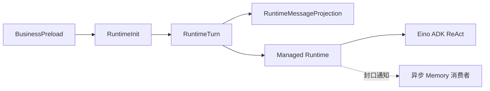

# 沐斯 AI 数字人教师 Runtime 设计

## 2026-10-28：L0—L3 学生记忆接入

### L1 由 L2 确定性生成

L1 的唯一内容来源是 L2。模型只生成 L2 的 summary、keywords 和结构化关键信息；keywords 先成为 L2 的正式字段。后台使用 Eino InvokableTool `extract_memory_index` 读取本次已校验、服务端绑定的 L2 文档，提取 keywords、所属学生、月份、版本与更新时间，计算指向该 L2 的路径，组成 L1。工具不再调用模型，不读取 L0 或 L3，不接受外部传入关键词，也不暴露为聊天 Agent 的写入工具。

L2 在发布前的受控暂存文档即为工具输入，L1 与 L2 随原有版本原子发布，避免先写 L2 再更新 L1 的中间状态。Redis 写入适配器再次校验 L1 必须等于 L2 的投影，拒绝独立编造的索引。对同一 L2 重建 L1 的结果一致。现有触发策略与 L3 同步时机不因本次修改改变。

旧文档没有 L2 keywords 字段时，使用 cmd/student-memory-reindex 指定学生重建：仅从 L2 已有结构化薄弱点名称补齐关键词（最多 20 项，无合适字段则为空），不会从旧 L1 反向补数据或再次调用模型。保留原摘要、证据和全部 L3 问答，更新共同版本后原子发布。

此节覆盖旧版本“长期记忆关闭”的说明；配置 `MUSI_REDIS_URL` 后启用。通用 Runtime 通过 `Contribution.LongTermMemory` → `Binding.LongTermMemory` → `<user-long-term-memory>` 注入。业务模块位于 `internal/modules/student/memory`。

四节点保持：business_preload 读取服务端绑定学生的 L0 与最近 6 个月 L1 → runtime_init 注册 student-memory Skill、read_student_memory/list_student_memory_indexes 工具与成功后唤醒 Hook → runtime_turn 执行 ReAct → runtime_message_projection 完成历史提交后唤醒后台。MySQL 轮次扫描负责断线、进程重启后的补偿，不依赖 Hook 必达。所有读取使用服务端身份，不接受模型传入学生 ID。

固定 SP 只放记忆使用规则；模型依相关性从 L1 读 L2，必要时从 L2 读 L3。较早月份可列索引。L0 最多注入 10 项观察、每项最近 3 条证据；历史证据仍完整存储。读取文档预算 96KiB，L3 默认每页 3 轮，最多 10 轮。超限拒绝，不静默截断返回原文。

自动注入的 L0＋L1 JSON 总预算为 6000 字节；超限先减少观察项与索引，再减少自述列表，设置 context_truncated=true。仅缩减本轮注入视图，不删改 MySQL/Redis 原文。网页“新对话”按钮立即创建服务端会话；与紧接着发送问题的建会话请求合并，避免重复或竞态。

提取条件：学生累计 10 轮未处理成功问答、新建服务端会话且存在旧会话待处理问答、最近学生输入满 2 小时。条件合并进同一来源进度。每次最多处理 10 轮，按北京时间月份归档；15 秒轮询，成功轮次/创建会话可提前唤醒。尚未提取进 Redis 的全文仍在 Agent Store 可查。

流程：读取 MySQL 指针与公开问答 → 相同百炼型号的独立后台调用生成 L2/关键词/候选（共享并发额度） → 验证证据引用 → Redis Lua 原子比较并替换三层 YAML → MySQL 事务合并 L0 候选并确认进度。学生填写字段不由提取覆盖。

每学生 3 分钟写租约，单次工作预算 150 秒；失败一分钟后可重试。Redis 成功但 SQL 确认失败时，重试根据 L3 来源去重，恢复 L0 与进度，不重调模型。旧 worker 不能覆盖新文档。L3 保留全文；模型输入只用有标记的限长摘录，摘要不代表模型看过被省略的全部内容。工具参数、模型推理、系统提示不写入记忆。

YAML 共同字段：schema_version、layer、student_id、month、revision、updated_at、next_paths、content。L1 的 content 只有 keywords，next_paths 指向 meta.md；L2 的 content 是 summary/key_information，next_paths 指向 content.md；L3 的 content 是 turns，next_paths 为 []。L4 暂不挂接。

边界：读取失败降级为当前题目教学，写入失败保留重试任务。当前面向单实例 Redis，不支持 Cluster 跨槽三键提交。每月文档最多 8MiB，L2 最多 1000 条关键信息，超限保留旧文档并报错；大规模分片、遗忘/纠错工作流和 Redis 全量丢失自动重建尚未交付。

版本：v7.0；更新：2026-10-27。参考《Agent SDK 与 Runtime 设计》以及《旧链路 Agentic 改造本质》的职责与生命周期原则，结合三张消息基础表＋独立压缩表、异步压缩、SP 文件更新方案实现。

> v8.0 当前交付（2026-10-27）：文字与拍照单题已接入网页。图片使用 Go MCP SDK 调用阿里云市场通用识别GPU，默认 Streamable HTTP，可配置 SSE。当前文件保存在本地私有目录，OSS 尚未接入。本章节覆盖下文历史方案中的实施状态，原有产品分期不变。
## v8.0 MCP OCR 交付

链路：网页上传 → 保存原图 → Agent Store 保留原始备注与图片引用 → 原有四节点图 → math-solve Skill → recognize_input_image → MCP OCR → 缓存 OCR → validate_solution → finalize_solution 事务入库 → 正式回执展示与历史修复。

真实联调：合成图片“解方程 2x+3=7，求x。”识别为“解方程2x+3=7，求x。”，经百炼解答和独立复核得到 x=2，原图/OCR路径及答案/解析/步骤均已保存。该样例不替代手写、复杂公式和数学质量评测。

一期只支持清晰完整、无需理解配图的单题；JPG/PNG/WebP，最大5MiB、4000万像素。不包含多题切分、图形理解、人工 OCR 修订。失败保留原图及待回答消息，无正式回执不宣称完成。

保留原有四节点图，MCP不是新增图节点；它是教学工具内部的服务适配。只在图片轮次且OCR已配置时注册recognize_input_image，文字轮次不开放该工具。Skill决定调用流程；Tool验证当前资产并执行识别；授权Hook验证Invocation、来源及技能加载。Hook不生成解答或替代提交事务。

模型只得到OCR文字、结果编号及哈希，不接收网关凭据、二进制和私有路径。复核读取服务端缓存原文，草稿及提交重新验证来源哈希：文字哈希保持旧实现，图片增加不可变asset_id及OCR原文。原图发往OCR前校验内容哈希，READY缓存不可变。

认领OCR时以短事务锁定资产和缓存行，租约120秒，外部调用在事务外执行；OCR上下文80秒、HTTP75秒、响应/事件8MiB。完成以有效租约和状态条件更新，旧执行不能覆盖READY。处理中返回忙，失败标记FAILED，不后台自动重试；学生显式重试可能再次计费。

回执OriginalInput保存原始备注，封口保留ImageAssetID。已提交结果以回执修复，不重跑OCR和模型。80%异步压缩策略保持，物理历史不删除，长期记忆仍关闭。

## 既有方案（历史实施状态以v8.0章节为准）


## 1. 三层边界

业务主链路由 Eino Graph 控制，业务模块通过 Registry.Contribute 注入能力；Managed Runtime 统一承接每轮执行；纯 SDK 只处理模型—工具循环。四个外层节点不是 ReAct 内部的模型/工具节点。



| 节点 | 代码职责 |
|---|---|
| BusinessPreload | 校验业务请求、解析 Registry、运行前置 Hook；可改写业务输入或短路 |
| RuntimeInit | 绑定服务端 Scope/Turn/Run/InputRef/lease，预分配 user/assistant 消息 ID，合并能力并创建 Runtime |
| RuntimeTurn | 调用 StreamTurn，启动有界 live EventSource，不在此消费事件 |
| RuntimeMessageProjection | 消费消息/工具/错误/结果事件，经 PacketHooks 投影并发送；EOF 后运行 PostRuntimeHooks |

真实代码为 internal/application/agentic/graph.go，使用 compose.NewGraph、AddLambdaNode、AddEdge、Compile。Graph 编译一次，每次 Invoke 使用独立 Turn。

## 2. 包结构

```text
internal/application/agentic/
  graph.go           # 四节点主图、请求到 Runtime 的适配
  registry.go        # Registration / Contribution / Feature
  projection.go      # Packet、业务生命周期及后置收口
internal/agent/adk/
  agent.go / run.go / model.go
  middleware/        # LifecycleHooks、策略、Eino 适配
internal/agent/runtime/
  runtime.go         # New/Config、静态配置与目录初始化
  run.go             # 统一整轮生命周期、修复入口
  lifecycle.go       # 每轮钩子链注入
  stream.go          # StreamTurn / EventSource
  factory.go         # 模型工具配置、预算与 canonical 状态桥接
  context/           # 静态块与 Preamble/Memory/UserPrefix
  prompt/            # Markdown SP 加载
  afs/               # Read/List、read_file/ls、FilesProvider、inmem/vfs
  skill/             # frontmatter 目录
  storage/           # 纯持久化契约、生命周期注入器
  event/             # TurnCompleted 与统一语义 Items
  model/proxy/       # 实际模型代理 Service 与 Resolver
  observability/     # Tracer/Span/Exporter、turn/model/tool span
  state/             # 中立 DTO；摘要正文是 opaque JSON
internal/agent/completion/  # Dialogue / Receipts 完成策略
internal/agent/memory/      # 引擎外压缩服务、事件消费者和本地投递适配
internal/modules/teaching/summary/  # math-summary-v1 业务结构
internal/adapters/persistence/mysql/agentstore/  # 三张基础表、独立压缩表与固定游标
```

SDK 不依赖 Runtime、数据库、AFS 或 Skill。Runtime 不定义高中数学摘要字段，不判断学生能力，不执行题目业务事务。照片 OCR 和教学事实由业务层负责。

## 3. Registry 扩展契约

Registration.Contribute 返回 Contribution；按注册顺序合并一次，形成当前请求快照。

- Tools：注册普通 Eino Tool；重复名称拒绝，避免静默替换动作权限。
- SkillPaths：技能名称到只读文件路径；同名称后注册覆盖，但 Runtime 校验文件 frontmatter 与名称一致。
- Features：返回受控 Runtime 生命周期钩子，例如模型输出治理。
- LifecycleHooks：进入统一 Runtime 钩子链。
- TurnProviders / StaticProviders / PreloadedFiles：注入上下文和只读文件。
- PreloadHooks：Runtime 前补上下文、改写输入或短路。
- PacketHooks：每次发送前后处理；BeforeSend 可以阻止发送。
- BusinessLifecycle：按 biz_name 开始/结束内容投影；完整文本默认结束当前业务段，其他处理器可显式 EndBusiness。
- ToolHandlers：将明确注册的工具结果转为可展示 Packet，默认不展示内部工具结果。
- PostRuntimeHooks：仅在事件源完全消费、主轮存储收口后执行。

Turn.Emit 让业务生命周期及后置 Hook 发送额外 Packet，仍经过统一 PacketHooks；整轮投影有 256 包预算。客户端断开/发送失败会取消源，不运行要求完整消费的 PostRuntimeHooks。

未实现额外卡片历史追加接口；当前产品没有卡片能力。不能借 PostRuntimeHook 改写已封口消息，后续产品若需要额外历史须单独定义追加与幂等契约。

## 4. 统一 Runtime 生命周期

Runtime 与 SDK 共用同一套有序 LifecycleHooks：guard、storage、trace 等内置钩子在前，业务在后。SDK 在 ManagedTurn 模式不重复执行 BeforeTurn/AfterTurn/OnError，只接管模型与工具阶段。

1. 校验服务端 Input/Guard，检查完成策略的幂等回执。
2. 固定本轮 Markdown SP；Provider 读取输入。
3. BeforeTurn：内置 Begin 锁定会话并持久化 raw user，再执行业务 BeforeTurn。
4. BeforeAssemble：业务可调整本轮输入；随后加载历史与摘要、Build 一次。
5. BeforeAgent / BeforeModelRewriteState / BeforeModel：重新检查 Guard、白名单、真实预算；调用模型。
6. AfterModel / AfterModelRewriteState：同步改写/审查，再解析工具调用。
7. BeforeTool：Allow 才真实执行；Deny/Confirm 不执行。AfterTool 处理最终结果。
8. 循环结束取 canonical 本轮后缀；Storage AfterTurn 先完成判定和封口，再运行业务 AfterTurn。
9. Provider、装配、模型、工具、封口或收尾失败统一进入 OnError，独立清理超时保障取消后的收口。
10. 发送 live 结果，结束事件源；投影消费 EOF 后执行 PostRuntimeHooks。

HookPolicy 支持 FailTurn、DegradeAndContinue、Compensate 和协作式超时。业务默认降级；失败的降级改写回滚整个 HookInput 消息副本，不留下半成品；补偿使用独立且有界的清理上下文。所有钩子与工具串行，教学 Runtime 拒绝并行工具批次。已封口后的业务 AfterTurn 显式失败以 WarningCode 报告并记录错误 span，不回滚已提交事实。

## 5. 通用完成策略与业务提交

默认 completion.Dialogue：模型无错误结束、原生协议完整、末尾存在最终 assistant 文本才进入封口；存储封口失败返回 STORE_SEAL_FAILED，不能把尚未持久化的普通回答报告为成功。生成 Kind=engine 的执行完成记录，CompletionID 是引擎完成编号，不声称提交了教学业务；CommittedResult 为空。

completion.Receipts：业务显式注入 Resolver，要求正式事务回执，保留已提交优先、精确终结尾部恢复、pending_repair 和禁止重跑等语义。旧 Config.Completion 兼容转换为此策略，新代码使用 WithCompletionPolicy。

同一逻辑 Turn 已封口时不调用模型/工具，live 新链路可回放已保存回答。HTTP 请求唯一键负责相同请求不同原文的冲突检查。

## 6. 上下文与技能

四段顺序固定：

1. system：identity、skill-reminder、user-memory-reminder 与静态扩展；不含每轮数据。
2. preamble：available-skills、稳定资料、preloaded-files。
3. memory：长期资料与 opaque JSON 历史摘要。
4. 原生未覆盖历史＋当前 user；易变信息经 SlotUserPrefix 合并。

Priority 仅在 Slot 内排序，属性按键排序、正文转义。同一轮只 Build 一次，loop 中消息由 Eino 追加。Builder 的 Snapshot 包含固定 SP 便于预算核对，不动态改写 SP。

Binding.Blocks 是中立的 Tag/Slot/Priority/JSON 上下文值；业务可注入 current-problem，Runtime 不再硬编码题目结构。教学摘要 DTO 在业务模块，Summary.Structured 为 json.RawMessage；旧数据库中的 JSON 对象保持兼容。

Snapshot.OriginalInput 保存学生原文；CanonicalInput 保存模型真正收到的 user。成功时同一 user 内容转为 canonical，ext.OriginalInput 保留原文；网页回读原文，模型历史回读 canonical。preamble/memory 不占消息链位置。

AFS 只 Read/List，read_file/ls 是普通工具；拒绝宿主机路径、遍历和未挂载文件。Skill 只解析 SKILL.md frontmatter，正文按需读取，无专属 skill tool。外部 VFS 要求 Client＋Authorize，可信 Invocation 在 Provider/上下文阶段即已注入。

SP 文件仍按轮读取并冻结，支持 Markdown、UTF-8/BOM/CRLF，128 KiB 上限；格式错误拒绝执行。默认教学 SP 与新文字聊天入口 SP 分开，避免普通对话被要求调用尚未上线的正式教学工具。

## 7. Storage、事件与异步 Memory

消息基础表为 agent_conversation、agent_message、agent_branch；新增 agent_memory_compact 独立保存结构化摘要及版本。契约与生命周期注入器分离，GetTurn 点查避免封口后回读全历史。成功一次事务封口，失败不保存 assistant 或中间过程，已接受 raw user 保留。

TurnCompleted 支持 completed/failed；成功只在 Seal 后发出，失败事件没有伪造成功位置。Payload 携带身份、完整 Items、Policy、Preamble/Memory。聚合 assistant 的多个语义 item 共用物理 MessageID/Seq，以 Index 排序。发送失败只告警，不反转提交事实。

Memory.Consume(Event) 是统一订阅入口：只消费 completed 并调度，不调用摘要模型。现有三表内的合并唤醒是本地持久投递适配，DispatchOne 点查已封口 Turn 重建相同事件，再调用 Consume；失败退避、成功确认。不要求增加事件表或引入消息队列产品。

ProcessOne 在事务外压缩，以 branch/epoch/覆盖前缀/revision/claim lease 做 CAS。默认全请求输入量达到可用输入预算 80% 且未覆盖历史多于 4 轮才触发，保留最近 4 轮；不是固定每 N 轮。摘要最多 2048。原始历史保留。数学摘要字段及来源证据校验由教学 Memory 管线执行。

ContextBudgetHandler 在装配安全预算超限时强制通知异步调度，Runtime 返回可重试错误而不等待摘要。配置百炼对话模型后，HTTP 服务自动启动后台 Worker，并与解题使用相同 BAILIAN_CHAT_MODEL；独立 Worker 可用于拆分部署。

## 8. 模型代理、追踪与恢复

proxy.Service 是已实现的进程内代理：只允许服务端模型别名，完整消息转发，实现 Eino ToolCallingChatModel，WithTools 返回独立实例。服务器实际通过它接入百炼。Redis/previous_response_id 不属于当前百炼 ChatCompletions 适配，不虚构缓存命中或增量恢复能力。

Tracer/Span/Exporter 已实现 trace_id、span_id、parent_span_id、起止时间、状态与安全属性；turn/model/tool 形成父子关系，异常路径关闭 span。默认日志 exporter 不写题干或工具参数，Recorder 有界保留 512 条用于诊断/测试；可替换生产 exporter，不依赖字节内部追踪平台。

Receipt 策略保留 Repair/RepairFromStore，重启后依赖完整 FrozenPrefix/TerminalObservation；缺原始来源则待修复，不补造轨迹。Forget、完整边界 Fork、固定游标与摘要失效规则沿用三表实现。任意中间 checkpoint 续跑仍不属于已确认三表成功整轮提交方案。

## 9. 实际入口与验证

- 原 POST /api/v1/messages 继续只保存输入，不启动模型。
- 新 POST /api/v1/agentic/chat 接收相同 query/conversation_id/client_request_id，服务端绑定学生，先复用原始消息，再运行四节点 Graph，返回 SSE。
- 配置 BAILIAN_API_KEY、BAILIAN_BASE_URL、BAILIAN_CHAT_MODEL 后启用；未配置返回 503，不伪造回答。
- 当前 SSE 是消息级实时事件；模型调用仍为非 token 流式，不能宣称逐 token 输出。
- go run ./cmd/agentic-demo：无需云凭据，运行实际四节点图，明确输出离线验证文本。

验证包括四节点顺序、注册/短路、前置改写、封口后 AfterTurn、完整消费后 PostRuntime、统一 OnError、降级回滚、span 关联与失败闭合、代理白名单与工具绑定、真实 MySQL HTTP→SSE→三表封口和重复请求回放。产品解题质量、正式教学事务、画像、费曼、OCR/OSS 和 RAG 仍按三期验收。


## 本次更新：独立记忆压缩存储（2026-10-27）

长期记忆暂不实现。本次仅处理会话历史摘要，不从摘要推断学生已掌握知识或长期能力。

- 三张基础表继续承载会话、原始问答和分支；`agent_memory_compact` 保存每次成功压缩的结构化内容，旧版本保留。`agent_conversation.ext.Summary` 只保存当前引用与覆盖元数据，不重复存正文。
- 解题与压缩均使用 `BAILIAN_CHAT_MODEL` 指定的同一百炼模型，服务启动后自动运行后台压缩。独立 Worker 也使用该变量，无需配置单独摘要模型。
- 默认应用上下文预算 16384、输出预留 4096，可用输入预算 12288；80% 向上取整为 9831。成功轮结束后优先采用供应商返回的完整请求输入 token 数（包含 SP、工具和上下文），没有供应商用量时使用保守估算，查询结果明确标注来源。
- 未覆盖历史超过 4 个完整问答轮次才有可压缩内容；保留最近 4 轮，压缩更早前缀。不是每 N 轮定期提取。摘要输出上限 2048 token，优先按供应商用量校验；无用量则用保守估算。
- 装配前的安全检查仍使用保守 UTF-8 字节估算，并非精确 tokenizer，因此可能在供应商真实输入达到 80% 之前触发强制压缩。当前请求不等待；返回可重试错误。只剩保留轮次或单轮过大时可能没有可压缩前缀，重试本身不能解决这类超限。
- 压缩模型调用在事务外；发布时在同一事务内新增压缩版本、校验分支/epoch/来源前缀/旧摘要 revision/任务租约并更新会话引用。过期结果不发布，失败按有界重试保留旧有效摘要。
- 压缩不更新或删除 `agent_message` 原始内容和哈希。下一轮仅以“摘要＋未覆盖完整问答”装配模型上下文。显式遗忘/删除是另一条数据清理流程。

### 验证接口

`GET /api/v1/conversations/{conversation_id}/messages?limit=100`

返回全部角色的存储消息，包含待回答输入和非当前分支；每页 1—100 条，通过 `next_cursor` 继续读取全部记录。学生身份由服务端绑定，不能通过参数访问其他学生。

| 字段 | 含义 |
|---|---|
| messages | 原始存储消息的 ID、角色、状态、分支、轮次、content.items、original_input、内容/前缀哈希、时间 |
| messages[].in_active_chain | 是否属于当前模型使用的分支链 |
| messages[].covered_by_current_compact | 是否被当前有效摘要覆盖；true 的原消息仍完整返回 |
| total_messages / next_cursor | 总消息数和后续页游标 |
| current_summary | 当前生效摘要、压缩 ID、revision、覆盖游标和模型 |
| recent_compacts / compact_versions | 最近 20 个压缩版本及全部版本数量；数据库保留全部版本 |
| last_model_usage | 最近成功轮模型输入/输出用量，source 区分 provider 与 estimate |
| policy / trigger_tokens | 当前默认配置与 9831 的触发阈值 |

分页期间消息集合、分支或摘要版本变化时返回 409，调用方重新从第一页读取，避免混合不同快照。原 `GET /api/v1/messages` 为输入记录列表，不用于验证完整对话。

### 部署与验收顺序

先显式运行 `go run ./cmd/runtime-db` 应用 004 迁移（003 基础表不变），再启动新版服务。已有会话内联摘要会迁移到独立表，原始消息不改；迁移可重复执行。不要让旧版写入端与新版压缩发布并行使用同一会话。

依次验证 80% 边界、结构化摘要及来源校验、两版摘要累计、原始消息内容/哈希不变、最近 4 轮上下文、完整消息分页、学生隔离，再验证真实百炼生成。强制压缩联调与 80% 自动触发测试分别记录，不把强制联调描述为真实用量达到阈值。


## 标识治理：自增主键与业务发号（2026-10-27）

四张表统一使用 `id BIGINT UNSIGNED AUTO_INCREMENT PRIMARY KEY` 作为内部行主键。`scope_key` 保留完整 `(namespace, subject_id, conversation_id)` 的隔离哈希语义，不改成自增数，不接受客户端直接传入。自增 id 只负责数据库行定位，不代替消息链位置、业务 ID、授权或幂等键。

| 字段 | 新数据规则 | 兼容规则 |
|---|---|---|
| id | 每张表独立自增；仅在该表内有意义，允许空洞 | 005 迁移为已有行补齐，后续迁移不重新编号 |
| conversation_id | 服务端 UUIDv7，`c_`＋32 位十六进制字符串，34 字符 | 已存在的会话号继续有效；普通消息接口不再按客户端自定义编号创建新会话 |
| branch_id | 服务端 UUIDv7，`b_`＋32 位十六进制字符串，34 字符 | 旧 ROOT 哈希/分支 UUID 不改写；已存在会话始终复用其实际当前分支 |
| turn_id | 接受新问题时发出 `t_`＋32 位 UUIDv7；幂等命中时直接复用 | 旧轮次号及其派生消息映射保持兼容 |
| message_id | 同一个服务端轮次号派生 `mu_`/`ma_` 两个消息 ID，35 字符 | 旧轮次沿用旧哈希映射，既有消息 ID、父引用和前缀哈希不改写 |
| client_request_id | 客户端请求幂等键，可继续使用 UUID；重试不更换 | 不与 message_id 或 conversation_id 混用 |
| compact_id | 本次不变，继续按压缩来源/版本生成内容关联哈希 | 独立的自增 id 不改变压缩版本和引用 |

统一发号实现为 `internal/platform/idgen`，复用当前依赖的 UUIDv7 实现，不引入新的发号表或外部服务。类型前缀方便识别；时间段有序，同进程同类型连续发号单调递增，多进程之间不保证严格全局顺序。业务时间查询使用 created_at，消息因果顺序使用 branch/position/parent_message_id，不能按业务 ID 代替。UUID 只是标识，不是权限凭证。

一轮成功问答仍只有两条物理消息。两条消息使用同一个已发出的轮次号，分别加 mu/ma 前缀，是为了在模型执行前预知身份，同时让重复提交、消息事件、展示投影和最终落库得到相同 ID。共享映射由 `state.MessageID` 实现；不在发送事件时重新随机发号。mu/ma 内的时间表示该轮的发号时间，并非助手完成时间。

### 创建与提交顺序

1. `POST /api/v1/conversations`，JSON 为 `{ "client_request_id": "本次创建会话的请求键" }`。返回服务端生成的 conversation_id、branch_id。
2. 创建请求的唯一约束为 `(namespace, subject_id, creation_request_id)`；同一学生重试复用同一会话。不同学生的相同请求键互不影响。会话和 ROOT 分支在一个事务提交。
3. 使用返回的 conversation_id 调用原有 `/api/v1/messages` 或 `/api/v1/agentic/chat`。未创建的会话返回 404，不能从消息入口绕过发号；已存在旧格式会话继续可用。
4. 消息使用原有 `(subject_scope, client_request_id)` 唯一约束幂等；命中时返回原 turn_id/message_id，不能重新发号。成功封口、SSE 投影与 TurnCompleted 事件统一引用同一套消息 ID。

网页新建对话先使用本地草稿标识，第一次发送前向服务端创建正式会话；草稿标识只用作会话创建的幂等请求键。丢失创建回执时重试仍取回同一正式会话。已有本地会话继续使用旧 ID，消息的本地 UI 标识与 client_request_id 不充当数据库 message_id。

### 迁移及实现顺序

先应用 003/004 基础迁移，再通过显式 `cmd/runtime-db` 应用 `005_identifiers.sql`。005 将原主键转换为唯一键，增加自增主键；保留 scope_key、消息/分支组合唯一约束、内容和哈希。MySQL DDL 不属于普通业务事务，逐表检查可重复执行；失败时修复后继续，不删除或重建旧数据。

落地顺序：自增主键迁移 → 统一发号器与旧号兼容映射 → 服务端会话创建及幂等 → 网页草稿转正式会话 → 消息/事件/分支联动 → 并发与迁移回归。迁移不重写任何历史业务 ID，不通过更新旧消息来统一外观。


## 当前基建核查与参考设计对应（2026-10-27）

结论：已经具备可运行的通用 Runtime 和四节点 Agentic 主链路；主职责划分遵循参考文档。当前交付是本地试点基础设施，不代表生产运行能力或数学题目业务已全部实现。文档存在、接口存在、正式入口已经注册三种状态必须区分。

核查依据：仓库《旧链路 Agentic 改造本质.pdf》第 4—10 页、《小荷 AI 医生 · Agent SDK 与 Runtime 设计.pdf》§6.2/6.3/6.4/6.6，以及实际服务入口 cmd/server/agentic.go。

| 参考原则 | 当前证据 | 判断与后续边界 |
|---|---|---|
| Graph 主干薄，四阶段串联 | internal/application/agentic/graph.go 以 Eino Graph 编译四个 Lambda 节点 | 已实现；解题业务不另写一套模型循环 |
| 业务通过 Registration.Contribute 注入 | registry.go 具备 Tools、SkillPaths、Features、Providers、Preload/Packet/Lifecycle/PostRuntime Hooks | 扩展接口已实现；正式服务器仍使用空 Registry，尚未注册数学业务模块 |
| SDK 仅模型—工具 loop，Runtime 管生命周期 | internal/agent/adk 与 internal/agent/runtime；ManagedTurn 防止 Hook 重复 | 已实现；业务 SQL、OCR 和解题状态机应在模块/service 中 |
| Context Builder 只做本轮入口装配 | context/builder.go、Markdown SP、摘要与完整历史区分 | 已实现；题目来源、版本等可信块仍需解题模块供给 |
| 先保留原始输入、成功后 reconcile/封口 | storage/inject.go、MySQL pending user、成功 user/assistant 聚合块 | 已实现；原文与 canonical 协议双视图，失败不伪造成功回答 |
| 压缩写侧异步，历史读取独立 | memory.Manager、agent_memory_compact、ContextView 与 Inspect | 已实现；80% 与保守估算的差异见压缩章节，长期记忆未启用 |
| Skill 目录和 AFS 读取技能正文 | skill/skill.go、afs、agent-design.SkillMount | 基础能力和技能模板已具备；当前 chat Spec 没有配置 math-solve/业务工具/文件挂载 |
| 工具边界与生命周期治理 | BeforeTool/AfterTool、工具白名单、运行/工具调用坐标、终结工具 | 通用机制已实现；任务归属、草稿、校验和 SQL 业务回执尚未接线 |
| 事件被统一投影再发送 | StreamTurn → EventSource → projection.go → SSE | 已实现消息级事件；尚非逐 token 流式。数学解答卡片的数据类型与 handler 尚未实现 |
| PostRuntime 依赖完整消费 | projection.go EOF 后执行 PostRuntimeHooks | 已实现触发边界；客户端断线可能无法抵达，不能承担唯一一次正式提交 |
| 可观测与可靠恢复 | turn/model/tool span、Receipt 完成策略、恢复前缀接口、幂等及 fencing | 通用机制和离线示例已验证；正式教学事务、持久恢复来源、修复 Worker/投影补发仍待实现 |

### 已知适配与未覆盖项

1. 参考实现依赖内部 RPC、IM、VFS 与 trace 平台；本项目采用本机 HTTP/SSE、MySQL、文件挂载及可替换 exporter。没有宣称接入原内部服务。
2. 历史定位采用分支/epoch/覆盖前缀证明，摘要单独存表并由会话引用；与参考文档的具体 anchor 编码不同，但保留异步写侧与只读上下文边界。不会把摘要当普通助手消息追加。
3. 本项目没有独立 IM 历史源，不实现参考文档中的 IM seam backfill；额外卡片历史 append 也尚未实现。成功工具协议已聚合进本轮 assistant 块，不应再重复追加同一份解答。
4. 当前服务为 loopback＋服务端固定试点身份。完整账号认证、跨实例配额、故障恢复部署和数学质量评测仍属于正式试点/上线验收项。
5. chat 使用 Dialogue 完成策略，普通最终文本即完成对话；SOLVE 必须配置 Receipts 策略和 finalize_solution 终结工具，不能沿用“有文字就成功”的判定。

### 题目业务接入的唯一入口

推荐新增一个服务端构造的 SOLVE 运行配置，复用同一四节点 Graph。首个实现可由独立 /solve 入口构造一份 Pipeline，明确配置 teacher-system.md、math-solve 技能、只读 SkillMount、数学工具和 Receipts 完成策略；/agentic/chat 保留通用聊天含义。后续需要合并路由时增加可信 SpecResolver，不能让模型参数选择任意 SP、工具或数据库表。

每个数学模块的 Contribute 只返回本轮授权能力，Hook 和 Tool 通过 runtime.Invocation/CurrentTool 获取服务端坐标。模块闭包只能保留当前请求的已授权引用，不能把学生 A 的上下文缓存在所有会话共享的可变全局对象中。数学题 DTO、校验器、Repository 和业务事务放在 internal/modules/teaching/solve，Runtime 继续保持通用。

### 会话记录界面

入口为 /conversation.html?conversation_id=...，聊天页右上角“会话记录”自动携带当前已保存的会话号。可选最近有输入的会话、按编号查询、筛选学生/教师/摘要覆盖消息、搜索已加载内容、翻页、查看原始数据与摘要版本。所有读取沿用服务端学生归属，不新增任意学生参数。

统计接口额外返回 active_chain_messages、compacted_messages、context_messages，均在同一数据库快照下计算全部当前分支消息；不使用当前页数量冒充全量。context_messages 为当前已封口且未被摘要覆盖的历史原文，包含最近完成的问答，不表示最近一次实际请求消息数。last_model_usage 仍为最近成功模型请求的测量；摘要 revision 不同时界面标为压缩前记录。预览旧摘要不会改变当前覆盖标记或写入数据库。


## v7.0 数学业务实际接入

cmd/server/buildAgents 构造 chat 与 SOLVE 两份运行配置，共用一个百炼进程内限流器和同一型号模型。SOLVE 注册 solve.Module，采用 Receipts 完成策略、finalize_solution 终结工具及只读 math-solve 挂载。外层四节点不变；业务 SQL 位于 mysql/teaching，通用 Runtime 不负责数学实体字段。

实际 Hook：TurnProvider 注入当前授权原题；BeforeTool 检查调用坐标/租约和输入归属，validate 前要求已读取技能；AfterTool 记录 math-solve 已加载状态；PostRuntime 只做本轮回执与历史对账。终结工具内部重复做数据库栅栏检查，因此不依赖提示词或 Hook 单独保证授权。模型每次最多一个工具调用，Bailian 请求显式关闭并行工具。

新增 Receipt.OriginalInput（可选，兼容旧回执）保存已授权原始 user。MySQL Finish 在无内存快照的恢复场景下使用该证明核对 raw 输入，再保存冻结的 canonical 协议；快照存在时仍以原始 Snapshot 核对。原文不是模型候选提供的字段。正式业务回执保留实际终结调用及完整本轮协议，重启恢复无需重跑模型。

MySQL conversation.ext.HistoryPolicy 记录最近成功轮次策略，Inspect 返回 policy_source；旧记录回退 default，新记录为 last_successful_turn。SOLVE 上下文含工具与技能，预算与普通 chat 分开，不再用 chat 的默认预算展示 SOLVE 用量。

接口采用同步 JSON 解题响应，网页显示“正在解题与校验”。四节点内部仍运行 live EventSource；本版未新增逐 token 解题流。会话记录页可以从已提交 finalize_solution 工具结果投影出正式答案，原始协议仍能展开检查。

## 解题 SSE 流式交付（2026-10-27）

网页使用 POST /api/v1/solve，提交原有JSON并设置 Accept: text/event-stream。未设置该Accept时保留原JSON响应，便于既有调用方兼容。请求格式/归属等前置错误仍以HTTP JSON返回；开始流后使用error和done事件表示失败。

事件：accepted（原始消息已保存）、progress（准备/识别/生成/校验/保存）、text_delta（模型公开文字增量）、draft_reset（开始新候选）、draft（答案/解析/步骤的待校验增量快照）、ocr（识别原文）、validation（是否通过及问题）、solution（数据库正式回执）、error、done。另每8秒发送heartbeat。event id只用于本连接顺序，不支持Last-Event-ID续传；断线后使用同一client_request_id重试，先读回执，已有结果不重跑模型或OCR。

主模型实际调用供应商Stream，边接收边投影，完整拼接schema.Message后再交给既有Eino ReAct同步Loop，所以四节点图和工具执行协议不变。只投影公开Content以及validate_solution候选中的answer/analysis/steps，不投影ReasoningContent、原始工具JSON、系统提示、密钥或独立复核器输出。每次生成受响应大小限制，增量草稿仅用于展示，不进入草稿校验/数据库保存逻辑；完整JSON仍须经既有严格校验及事务提交。

页面将流式内容标记为“待校验，尚未正式入库”，只有收到committed=true正式回执才显示已保存。校验修订会替换当前候选；失败保留原图、原始消息、OCR和公开反馈。OCR公式缺损应重传清晰完整题目或改用文字，不将重复解题视为重新OCR。

SSE写入带锁，防止心跳与模型分片交错；刷新失败取消执行；每次写入有15秒期限。请求预算与原185秒范围一致，客户端总等待210秒。流中断在提交前不生成正式题目，提交后仍以回执修复并幂等重放。

### SSE投影稳定性（2026-10-27）

同一请求重复的草稿快照和阶段进度在SSE写入边界去重；不重新拼装或重跑模型。网页保留消息/图片/步骤节点，只增量更新公开文本，用户阅读旧内容时不强制滚动。完成回执仍是正式解答的唯一依据。此变更不修改四节点编排、记忆策略、工具执行及提交事务。
