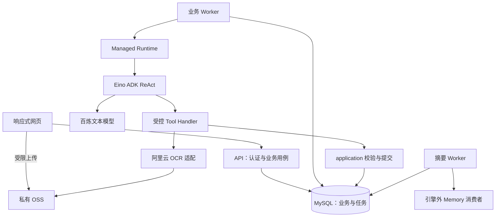
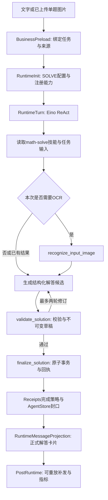

# 沐斯 AI 数字人教师技术方案

## 2026-10-28：学生画像后端交付

L1 索引通过后台 Eino Tool extract_memory_index 从已校验 L2 的 keywords 及元数据生成；不独立调用模型、不接受外部索引内容。先构造 L2，再执行工具生成 L1，最后原子发布。现有文档的重建命令为 `go run ./cmd/student-memory-reindex -student-id <学生ID>`，可加 `-month YYYY-MM` 限定月份；重建不调用模型、不改写摘要证据或 L3 原文。

新增 internal/modules/student/memory：分层 YAML 契约、路径/证据校验、三条件提取调度、按需读取工具及应用 Skill。MySQL 适配位于 persistence/mysql/studentmemory，Redis 适配位于 persistence/redis/studentmemory；百炼提取器继续使用 Eino BaseChatModel，无第二套模型 SDK。

启用方式：运行 cmd/runtime-db 建表；配置 MUSI_REDIS_URL；启动服务器。没有配置 Redis 时保持原解题功能且画像接口返回未配置。配置但依赖不可用时启动报告明确错误；运行中的记忆读取失败可降级，提取失败延迟重试。L0 存 MySQL，L1—L3 存 Redis YAML；L4 暂不实现。细节见 Runtime设计与数据库设计的 2026-10-28 章节，它们覆盖旧版“长期记忆未接入”的状态。

接口统一使用服务端绑定的学生身份：GET/PUT /api/v1/student/profile；GET /api/v1/student/memory/indexes；GET /api/v1/student/memory/document?path=绝对路径&offset=0&limit=3；GET /api/v1/student/memory/status。PUT profile 的输入为 {revision,basic}；revision 从 GET 获得，冲突返回 409。画像自述字段包括 name/grade/weak_subjects/weak_knowledge_points/weak_abilities/learning_goals/explanation_preference。文档接口返回 YAML，索引/状态/画像接口返回 JSON。不提供学生 ID 参数或任意 Redis key 访问接口。

版本：v7.0（SDK/Runtime 职责对齐）；更新：2026-10-27。

> v8.0 当前交付（2026-10-27）：文字与拍照单题已接入网页。图片使用 Go MCP SDK 调用阿里云市场通用识别GPU，默认 Streamable HTTP，可配置 SSE。当前文件保存在本地私有目录，OSS 尚未接入。本章节覆盖下文历史方案中的实施状态，原有产品分期不变。
## v8.0 MCP OCR 交付

链路：网页上传 → 保存原图 → Agent Store 保留原始备注与图片引用 → 原有四节点图 → math-solve Skill → recognize_input_image → MCP OCR → 缓存 OCR → validate_solution → finalize_solution 事务入库 → 正式回执展示与历史修复。

真实联调：合成图片“解方程 2x+3=7，求x。”识别为“解方程2x+3=7，求x。”，经百炼解答和独立复核得到 x=2，原图/OCR路径及答案/解析/步骤均已保存。该样例不替代手写、复杂公式和数学质量评测。

一期只支持清晰完整、无需理解配图的单题；JPG/PNG/WebP，最大5MiB、4000万像素。不包含多题切分、图形理解、人工 OCR 修订。失败保留原图及待回答消息，无正式回执不宣称完成。

Go SDK：github.com/modelcontextprotocol/go-sdk v1.8.0；go.mod最低Go1.26.0，本机1.26.10。Streamable HTTP与SSE均有本地SDK服务测试；真实服务已验证Streamable HTTP。只发现并调用精确工具名“通用识别GPU”，不将远端工具全集注册给模型。image为服务端读取绑定资产后的Base64；configure默认output_prob=true、output_keypoints=true。

提供方text包含JSON和参数说明，适配器仅解析首个success=true对象中的ret[].word，按提供方顺序拼接，不把参数说明当题干，不猜测数学符号。保留JSON内坐标、置信度和request_id。空结果、错误或格式异常停止解题。

配置项：MUSI_OCR_MCP_URL、MUSI_OCR_MCP_TRANSPORT（streamableHttp/sse）、MUSI_OCR_TOOL_NAME、MUSI_ASSET_DIR。服务与迁移命令加载忽略提交的.env，环境变量优先，网关凭据不进入源码/日志/模型。当前使用用户提供的HTTP网关，HTTPS探测未成功。不会在tools/call后自动重试或切换传输，避免重复计费。

新增接口POST /api/v1/images（multipart image）；GET /api/v1/images/{asset_id}（元数据及缓存OCR）；GET /api/v1/images/{asset_id}/content（原图）。/messages、/solve增加可选image_asset_id，照片query为空规范为[图片题目]。普通/agentic/chat拒绝图片。

当前没有OSS配置，使用internal/adapters/assets/local的os.Root文件边界，目录默认var/private-assets。文件不由静态路由公开，读取先验证当前学生。切换OSS实现photo.Files，不改变解题链路。

## 既有方案（历史实施状态以v8.0章节为准）


## 1. 当前实现与方案边界

| 状态 | 内容 |
|---|---|
| 已有代码 | Go/Eino Runtime、进程内上下文快照、会话记忆、异步压缩、内存/MySQL Store、百炼兼容模型适配、离线演示与摘要 Worker |
| 已有资源 | 项目内可编辑 Markdown 教师 SP、编译期嵌入的 math-solve / step-tutor / weakness-diagnosis Skill，以及 11 项业务工具输入契约 |
| 尚未实现 | 正式账号/模型解题 HTTP/网页、题目业务表及提交事务、阿里云 OCR/OSS 业务适配、11 项正式教学工具、共享配额、二期教学与三期题库 |
| 尚未验证 | 真实百炼/OCR 账号联调、数学质量、线上容量与成本；离线模型测试不代替这些验证 |

SDK 以 go.mod / go.sum 为准：最低 Go 1.24；本地已配置 Go 1.26.10 windows/amd64；Eino v0.9.22、eino-ext OpenAI 适配器 v0.1.13、MySQL 驱动 v1.9.3。依赖升级须回归，不使用浮动 latest。

## 2. 三期交付与依赖

| 阶段 | 开放能力 | 不能提前成为本期上线依赖 |
|---|---|---|
| 一期 | 单题文本/照片解答、四项结果、结构化入库、个人题目列表与管理 | 学习画像、引导、个性化解析、费曼验证、公共题库/RAG |
| 二期 | 学习信息与目标、证据画像、卡点引导、个性化解析、费曼验证 | 公共题库、相似题、完整考试系统 |
| 三期 | 授权题库、导入审核发布、RAG 检索、相似题目的与理由 | 未确认的全题型批改、随机考试、语音/形象数字人 |

一期照片限定为清晰完整、无需理解几何配图/函数图像的单题；一题多个小问保留整体。采用阿里云 OCR，模型只接收文字与公式。图形理解、学生端多题切分、OCR 修正和内容容错不列入一期，未来启用需按需求评审。

## 3. 总体结构与选型

采用 Go 模块化单体，一个工程提供 API 与 Worker 入口。摘要 Worker 已存在，正式 API/业务 Worker 尚待实现。首期面向 100—500 名学生、5—10 个并发 AI 请求。



| 层 | 方案 | 边界 |
|---|---|---|
| 网页 | 建议 React + TypeScript + KaTeX | 手机上传与公式阅读、电脑并排查看；不保存供应商密钥 |
| HTTP | net/http 或 Gin，按团队确定 | DTO、认证、授权与用例入口，不直接执行 Agent |
| 业务 | application＋模块 Service/Repository | 管题目事实、教学状态、画像规则与事务 |
| 智能体 | 纯 Agent SDK（Eino ChatModelAgent/Runner）＋Runtime AFS/Skill | 复用 ReAct，不自行复制模型/工具循环 |
| 数据 | MySQL＋结构化列/JSON | 业务权威记录；不引入 MongoDB |
| 文件 | 私有 OSS | 原图与必要大文件；数据库保存资源引用 |
| 调度 | MySQL 持久化任务 | 租约、重试、幂等、恢复；不建设独立消息平台 |
| 部署 | 建议 ECS 容器＋RDS MySQL＋OSS | 单 Worker 起步，多副本前落实共享配额 |
| 三期检索 | 独立可重建索引，产品待选 | MySQL 仍保存题库权威内容；不因 RAG 默认增加 MongoDB |

## 4. 模块职责与数据边界

| 模块 | 职责 | 不负责 | 启用阶段 |
|---|---|---|---|
| M01 账号 | 管理员发放、激活/登录/停用、认证身份 | 学习能力判断 | 一期 |
| M02 资源/OCR | 上传授权、对象验证、资产引用、OCR 结果与缓存 | 补题、理解图形或生成答案 | 一期 |
| M03 知识体系 | 稳定知识编码、目录与版本；二期加能力标签/规则 | 题库运营、模型自动创建标签 | 一期起 |
| M04 题目 | 输入快照、题目/解答版本、步骤、个人收录、去重与删除 | 教学步骤迁移或画像结论 | 一期 |
| M05 教学 | 选卡点、会话状态、个性化解析、费曼量规与结果 | 任意改标准答案、把提示表现算独立掌握 | 二期 |
| M06 学习档案 | 自述信息、证据校验、画像聚合、关注等级与重算 | 无证据猜测掌握、直接执行模型 | 二期 |
| M07 任务/配额 | 业务队列、租约、fencing、幂等与配额 | 决定数学正确性或教学动作 | 一期起，待实现 |
| M08 Runtime | RunTurn、Context、Factory、预算、Store、完成判定 | SQL 题目业务、画像等级和身份推断 | 共用基础，已实现部分 |
| M09 Tool/草稿 | 参数/引用校验、冻结候选、终结工具适配 | 绕过 Service 写库、独立网关服务 | 一期起，正式工具待实现 |
| M10 云适配 | 模型、OCR、OSS，错误与用量映射 | 业务成功状态、自动换未评测模型 | 一期起 |
| M11 HTTP/网页 | 账号、输入、轮询、结果及按期页面 | 根据自由文本判成功、直接访问云模型 | 各期 |
| M12 评测/运维 | 教师评测、成本、审计、回归与恢复演练 | 公共题库运营或学生推荐决策 | 各期 |
| M13 题库 | 授权资料、导入、审核、发布与版本 | 学生私有题自动公开 | 三期 |
| M14 检索 | 索引投影、过滤/召回/重排、相似理由 | 修改题库审核答案、承诺掌握概率 | 三期 |

调用方向为入口 → application → 模块接口。Tool 转到 application/只读服务；领域模块不反向引用 Runtime 或云 SDK。跨模块事务由 application 协调，每个 Repository 只处理自身表。

当前实际目录见 [Runtime设计](Runtime设计.md)。后续按模块逐步增加 internal/modules、internal/application、internal/transport/http、web 等目录；这些目录出现在设计中不代表已实现。

## 5. 一期解题与可靠入库

### 5.1 输入、资源与 OCR

1. 登录后将原始 query 直接存为 Agent Store 的 RECEIVED user，题干/可选错解分别保留并绑定学生身份；不写 submissions。
2. 图片先申请受限 OSS 上传凭证；只允许指定对象写入，完成后验证所有权、大小和实际类型，资源置为 READY。
3. API 接受已验证 asset_id，不接收任意外部 URL。建议 JPG/PNG、每个区域首期一张、单图不超过 10 MB；限制需产品验收确认。
4. 纯文字跳过 OCR；图片 OCR 结果保存原响应引用、规范文本、公式/有序块、请求 ID、API/适配版本。
5. 缓存键包含资产哈希、用途、供应商/API 与适配/配置版本。错误 OCR 不因缓存而成为永久业务事实，适配升级产生新结果。

优先验证阿里云单题识别接口，手写数学另做样本评测；配图坐标不等于图形语义。只做确定的空白/编码处理，不用模型补条件、改符号或把错解并入题干。手写输入未达标须保留未完成项，不能静默缩减验收范围。

### 5.2 同一条文字/照片链路

```text
POST submission + Idempotency-Key
→ 冻结输入/资源引用 + 创建 SOLVE job
→ Worker 领取带租约任务
→ 复用或执行 OCR
→ SOLVE Spec / math-solve Skill
→ validate_solution 校验并冻结草稿
→ finalize_solution 调用业务短事务
→ 正式题目/解答/步骤/提交关联 + 任务成功 + 回执/修复待办
→ API 读取同一正式版本展示四项结果
```

默认输出答案、解析、步骤、知识点。校验包括 Schema、字段/长度、选项/小问、稳定 step_id、知识编码、原输入来源及适用的数学复核；结构合法不等于数学正确。候选修订与供应商重试分开计数并受总预算约束。

一期即保存可选错解原文，但不触发 DIAGNOSE 或画像任务。未有学生作答时不创建“学生已作答”事实；模型解答是 solution，不是 attempt。

### 5.3 正式提交、去重与删除

冻结草稿绑定学生、submission/job、Run、lease token、输入与规则版本、payload hash、过期时间。finalize 只接收 draft_id，不接收新正文；事务重新验证租约、草稿、资源/题目未删除和所属关系。

同一事务保存题目及不可变版本、解答/步骤、知识关联、提交/可选作答关联、幂等结果、草稿提交标记、任务成功、提交回执与 RUNTIME_RECONCILE 待办。外部 API 不在事务内调用。

消息层中，终结事务还冻结原 ToolCallID 对应的精确返回载荷。随后 Agent Store 原子发布 user/assistant 两个完整消息块与 head/outbox；中间失败恢复原协议，不重新提交业务。三表 MySQL 已实现整轮原子提交；运行中轨迹/快照只在内存。正式终结工具需在业务回执冻结恢复前缀及精确返回，供重启后补写。

题目指纹只确定候选范围，合并前核对规范题干、公式、选项、小问与条件；不同数值/条件不合并。保留每次真实提交，HTTP 重试不新增作答。重新解题新增 solution 版本，个人分类与标准标签分开。

删除在业务事务中撤销可见性、取消任务/绑定并创建资源清理待办；后续异步删除 OSS 和 Runtime 记忆。业务 Guard 必须阻止已撤销输入重新创建记忆。数据库与 OSS 不宣称跨系统事务。

## 6. 模型、账号与任务策略

### 6.1 模型接入

沿用 eino-ext 的 OpenAI 兼容模型适配接入百炼 Chat Completions。APIKey、BaseURL、地域、模型、输出上限与超时取部署配置；不把其他产品的 Responses/应用工作流地址混入该适配器。

按场景指定模型引用并记录版本，未经评测不自动切换型号。主 Agent 用 tool_calls 提交结构化候选，不默认同时打开全局 JSON 模式；独立复核可以使用适配支持且已实测的结构化输出。

摘要模型和数学复核也计入调用额度与成本。当前 Limiter 仅进程内；独立摘要进程与业务 Worker 的配额必须共同规划。多副本/全局 10 调用目标依赖待实现 provider_call_slots，不能把每个进程的 10 相加当总限制。

### 6.2 账号与任务

管理员发放试点账号、首次设置密码，登录态与资源授权在服务端。姓名/年级是否首次强制收集仍按需求待决策；学习目标/偏好/画像二期采集，不成为一期登录的隐含前提。

业务 jobs 建议状态：PENDING、RUNNING、RETRY_WAIT、SUCCEEDED、FAILED、CANCELLED，stage 区分 OCR/GENERATE/VALIDATE/PERSIST。SKIP LOCKED 短事务领取，写 lease_until 与单调 fencing token，执行时心跳；过期重领生成新 RunID，保留 TurnID。

写检查点和提交均验证 token。检查点包含冻结 OCR/候选/来源版本；旧租约草稿不可直接提交，重试需重新绑定和校验。租约/回执查询不确定不能被解释为“确认未提交”。

429、暂时网络/部分 5xx 可有限退避；权限/配置错误直接告警。SDK、工具、队列重试统一记账，避免多层隐式放大。建议 SOLVE 120 秒、引导 60 秒、诊断 90 秒、OCR 单次 15 秒，仅是预算起点，须联调校准。

## 7. Agent、SP、Skill 与 Tool

### 7.1 配置与发布

教师身份/通用规则为稳定 SP，场景能力由服务端 Spec 决定。Skill 是按需加载的教学指令，不能增加工具权限。模型按 ReAct 选择读信息、候选修订与提交动作，业务层管理事实。

| 场景配置 | 阶段 | Skill/能力 | 状态 |
|---|---|---|---|
| SOLVE | 一期 | math-solve | 已有 Skill/输入契约，业务工具待实现 |
| TUTOR_TURN | 二期 | step-tutor | 已有基线，待接教学状态机 |
| DIAGNOSE | 二期 | weakness-diagnosis | 已有基线，待接证据与画像 |
| PERSONALIZE | 二期 | 个性化解析 | 新业务 Spec/Skill/契约待设计实现 |
| FEYNMAN_TURN | 二期 | 解释量规与追问 | 新业务 Spec/Skill/契约待设计实现 |
| SIMILAR_SEARCH | 三期 | 检索目的、过滤、召回/重排 | 新业务 Spec/工具待设计；不要求每次检索必须跑 Agent |

后二期新增键为规划名称，不是当前已存在的模式枚举。服务端只装配已发布能力；用户文本、Skill 和模型参数不能改变身份、模式或资产白名单。

### 7.2 已有 11 项工具输入契约的分期

| 阶段 | 工具 | 职责 |
|---|---|---|
| 一期 | get_task_input | 当前绑定的原始输入及白名单引用 |
| 一期 | recognize_input_image | 授权图片 OCR/检查点读取 |
| 一期/二期 | get_knowledge_catalog | 受控知识目录；二期再开放能力分类 |
| 一期 | validate_solution / finalize_solution | 校验冻结与正式提交 |
| 二期 | get_question_context / get_tutor_context | 只读指定题目、来源与固定步骤 |
| 二期 | validate_tutor_turn / finalize_tutor_turn | 教学动作校验、轮次与状态提交 |
| 二期 | validate_diagnosis / finalize_diagnosis | 证据定位、冻结与画像提交 |

契约源文件是 [tools.json](../agent-design/contracts/tools.json)，Skill/SP 位于 [agent-design](../agent-design/)。它们是产品资源，不安装到开发者的全局技能目录。Runtime 提供普通 read_file/ls，技能目录只包含授权文件元数据，不注册专属 skill 工具。上线前将 Schema 的引用展开并适配供应商子集，不能直接把整份目录文件发给模型。

一次模型响应最多一个 tool_call，终结工具 ReturnDirectly 独占批次。自然文本结束没有正式回执即 AGENT_INCOMPLETE。通用执行/异常/记忆规则见 [Runtime设计](Runtime设计.md)。

## 8. 二期教学的技术增量

### 8.1 信息、个性化与画像

学习信息保存自述来源/时间，偏好允许修改；自评不直接转成已证实薄弱项。Provider 读取相关信息快照，缺少时回退标准解析。

个性化解析引用标准 solution 版本和学习信息/证据快照，保留策略/模型版本；不覆盖标准解答。验证题目条件和最终答案一致，失败保留标准版本。validate_personalized_solution / finalize_personalized_solution 为拟新增工具，须同步 Go DTO、Schema、Skill 与评测。

证据必须引用学生真实作答，通过 source_record_id、quote、occurrence_index 精确定位；UTF-8 偏移由服务端计算，不让模型编字节索引。标签取教师审核目录，等级由规则聚合；重复来源不重复计数，空证据合法。证据删除/纠正后重算，最近出现时间取来源发生时间。

### 8.2 卡点引导与费曼验证

引导绑定题目版本、solution_id 和 step_id。请求带 state_version；事务预约 pending_turn，模型在事务外执行；提交再校验会话 ACTIVE/版本/租约，写输出并清除 pending。退出递增版本，晚返回任务不得推进旧状态。

费曼独立记录验证目标、量规版本、学生解释、追问、分项证据与状态（达标/部分达标/需帮助/待验证）。拟新增 get_feynman_context、validate_feynman_turn、finalize_feynman_turn；最终状态必须经业务量规校验，不能由任意自由文本直接变为掌握分数。

答案曝光、提示、示范、跳步分别记录。辅导与解释表现不冒充独立解题；二期量规/概念追问模板不是公共题库，不依赖 RAG。不同会话 Scope 隔离，需要的前序上下文由授权 Provider 明确引用。

## 9. 三期题库与 RAG 增量

题源仅自有/授权资料：导入 → 题目切分及答案关联 → 知识/方法/难度标注 → 去重 → 教师审核 → 发布。检索单元是完整题目及必要子结构，保留来源/授权/审核/版本。

按同类、同解法、补薄弱点分别建评测目标。结构化条件过滤＋关键词/向量召回＋重排，具体引擎与模型待样本基线后选择。无画像也可按题目匹配；生成相似理由可用 RAG，单纯检索不必强制经过模型。

MySQL 保存权威题库；索引是可重建投影。发布事务写 INDEX_UPSERT/DELETE 待办，消费者按题目 ID＋内容版本幂等处理，拒绝旧版本覆盖新版本。展示前再次校验发布/授权/删除及版本，不把索引可命中当作可访问。

默认建议 3—5 个真实结果，说明相似依据与来源；不足时不伪造生成题补齐。学生个人题目不自动进入公共索引。完整测验/批改是未确认扩展；如启用一道新题验证，单独记录答案揭晓、帮助与独立作答条件。

## 10. API 与运行观测规划

以下为拟建接口，不是已部署 API；正式 OpenAPI 以实现评审为准。

| 阶段 | 接口组 | 关键契约 |
|---|---|---|
| 一期 | /auth、/assets、/messages、/jobs/{id}、/questions | 认证身份、Idempotency-Key、202＋任务 ID；结果读正式版本 |
| 二期 | /learning-profile、/tutor-sessions、/personalized-solutions、/feynman-sessions | 会话/来源版本、并发冲突、帮助条件与证据来源 |
| 三期 | /question-bank（运营）、/similar-questions、/search-feedback | 权限角色、发布状态、查询目的、结果 ID/版本与理由 |

一期建议每 2 秒轮询、离页/终态停止。完整校验提交后再展示四项内容；不向学生旁路推送内部候选或推理。服务端记录排队、OCR/模型/工具/存储耗时、用量、重试、错误、回执、来源与配置版本；日志默认不包含密码/密钥/完整学生正文。

## 11. 验收与实施约束

一期先文字闭环，再照片与资源，再账号隔离/幂等/删除/故障恢复和教师评测；二期新增个性化正确性、引导和费曼量规、证据纠正；三期新增授权与索引一致性、不同相似目的的检索质量。详细门槛以需求文档为准，执行顺序见 [实现顺序](实现顺序.md)。

质量、数据一致性和能力覆盖分开报告。现有离线示例仅验证基础设施，不能算真实数学题已验收。首期不因现有教学 Skill 而提前开放二期功能，不创建三期空服务。需要调整业务契约时，同步文档、tools.json、Skill、DTO、前端类型、数据迁移及评测样本。

## 12. Agent Store：消息基础表与压缩表边界

用户已确认按小荷参考的一期策略：agent_conversation 保存会话当前指针/版本/租约元数据及当前 Memory，agent_message 保存成功轮次 user＋聚合 assistant，agent_branch 保存 fork 关系。详细 DDL 见数据库设计。

运行中 SaveSnapshot/Append 是进程内 buffer；执行失败不写 assistant，已接收 user 保留，不另建 Run、Item、Snapshot、事件或压缩任务表。压缩内容存入 agent_memory_compact；当前摘要引用及最多 8 条压缩状态、1 条合并唤醒放在会话扩展，保持后台异步压缩和超限可重试。分支游标含 branch/position/message，不能跨分支比较单个 position。

业务已提交但消息写失败仍不能重做。生产终结事务须冻结 RecoveryPrefix 与精确 TerminalObservation，修复直接补写原完整协议；缺少来源时待修复。生产业务完成回执/修复队列仍待 M07/M09 实现。

原十表代码/DDL 与文档已归档，education 库原十张空表由显式维护命令退役，原有五张业务表不改。命令默认创建/校验三张基础表及独立压缩表，旧表存在非空数据则拒绝清理，不自动迁移。

与参考差异：当前只追加整数 position，没有中间插入产品需求，未实现 fractional/InsertAfter；摘要属于 Memory，不作为 assistant 插入历史；不持久化供应商隐藏推理。真实教学质量、生产容量仍需评测。


## 13. 当前 query 直接进入 Agent Store

web/ → 同源 Go HTTP /api/v1/messages → Agent Store NewQueries，只写三表。conversation 保存会话、branch 保存 ROOT 关系、message 保存实际 user 原文；待回答状态 RECEIVED、未分配完整链位置，不伪造 assistant。

接收问题与完成回答分开：原始输入立即持久化；后续 Begin/Finish 复用该 user，完成后才参与模型完整历史与摘要。服务端绑定学生，输入校验、请求唯一键和 QueryHash 负责原文保留、幂等/冲突，页面刷新直接从 Agent Store 回读。

此前 submissions 已退出当前读写链路；两条已有输入完成校验导入，旧数据只保留，不新增写入。正式认证、任务/解题/OCR/业务完成事务仍按后续阶段推进。


## 14. 当前上下文编排实现

固定 system SP→preamble 技能目录→memory（长期资料＋结构化摘要）→原生完整历史→当前 user（可选题目和运行约束前缀＋student-input）。具体字段、缺省和角色见 Runtime设计第 6 节。

技能目录由真实注册表按本轮 Spec 授权生成，长期资料/当前题目由可信 Provider 提供；两者不等于新建画像采集服务。数据区块不能改变工具权限。标签只改变模型输入副本，不改变原始消息和业务恢复源。摘要 JSON 采用带来源引用的 math-summary-v1，在独立 agent_memory_compact 表中按版本保存。


## 15. 固定 SP 的编辑与发布边界

固定 SP 保存在 agent-design/prompts/teacher-system.md，由 Runtime 每轮开始读盘并冻结，修改后下一轮生效，不重新编译。Spec.InstructionFile 与可选 MUSI_SYSTEM_PROMPT_FILE 负责文件定位，路径只由服务端配置；学生输入不能选择提示词路径。显式内联 Instruction 模式仅按传入字符串运行。

文件读取和三段标签校验失败时不调用模型/工具；每轮快照记录 PromptSource/PromptHash。技能加载方式和 Agent Store 三表不变。真实模型使用新的 SP 仍需教学评测，离线热更新测试只验证读取/冻结/恢复边界。


## Runtime v4.0 对齐（2026-10-26）

以参考 PDF §6.2～§6.7 最终修订为准：adk 仅纯循环，runtime 装配上下文、AFS、Skill、Storage hook、事件、模型代理和观测；异步压缩在 internal/agent/memory。详细接口与当前边界见 [Runtime设计](Runtime设计.md)。

静态 SP 不含题目或学生数据。每轮为 system→preamble→memory→原生历史→当前 user；当前题目和运行约束合并到 UserPrefix。Skill 目录由 SKILL.md frontmatter 构建，正文通过普通 read_file 加载，不使用专用 skill tool。模型只接收完整逻辑上下文，尚未实现 Redis/previous_response_id 缓存。

成功时 Storage 注入器 reconcile 最终改写后的本轮消息，三表事务封口后发送 TurnCompleted；事件失败不反转成功。原始输入保存在 user.ext.OriginalInput，模型历史保存 canonical 输入；网页原文回读不变。当前网页只保存问题，未接真实模型解题。


## v5.0 新链路：四节点 Eino Graph（2026-10-27）

BusinessPreload→RuntimeInit→RuntimeTurn→RuntimeMessageProjection 是实际 compose.Graph，位于 internal/application/agentic；Registry.Contribution 注入 Tools、SkillPaths、Features、Preload/Lifecycle/Packet/PostRuntime Hooks、上下文 Provider 与预加载文件。主图不硬编码教学业务。

Runtime 使用统一生命周期；普通对话默认 Dialogue 完成策略，正式教学任务继续显式注入 Receipts 策略，已提交优先与 pending_repair 不变。数学摘要类型移至 internal/modules/teaching/summary，Runtime 只读取 opaque JSON；业务题目信息通过 Binding.Blocks 注入。

新 API POST /api/v1/agentic/chat 先复用 Agent Store user，运行四节点后以 SSE 输出消息级事件。百炼环境变量为 BAILIAN_API_KEY、BAILIAN_BASE_URL、BAILIAN_CHAT_MODEL；未配置返回 503。原 /api/v1/messages 与现有网页按钮仍只保存输入。新 API 的文字回答不等于正式 question/solution 业务事务已上线。

proxy.Service 已提供模型白名单、完整上下文转发与独立工具绑定；Tracer/Span/Exporter 提供关联的 turn/model/tool span。Memory 通过 Consume(TurnCompleted) 统一消费，本地三表合并通知为持久投递适配。Redis 模型缓存、token 级流式、生产追踪后端和额外卡片历史不属于本次交付。最新接口以 Runtime设计 v5.0 为准，v4.0 历史快照已归档。


## 本次更新：独立记忆压缩存储（2026-10-27）

长期记忆暂不实现。本次仅处理会话历史摘要，不从摘要推断学生已掌握知识或长期能力。

- 三张基础表继续承载会话、原始问答和分支；`agent_memory_compact` 保存每次成功压缩的结构化内容，旧版本保留。`agent_conversation.ext.Summary` 只保存当前引用与覆盖元数据，不重复存正文。
- 解题与压缩均使用 `BAILIAN_CHAT_MODEL` 指定的同一百炼模型，服务启动后自动运行后台压缩。独立 Worker 也使用该变量，无需配置单独摘要模型。
- 默认应用上下文预算 16384、输出预留 4096，可用输入预算 12288；80% 向上取整为 9831。成功轮结束后优先采用供应商返回的完整请求输入 token 数（包含 SP、工具和上下文），没有供应商用量时使用保守估算，查询结果明确标注来源。
- 未覆盖历史超过 4 个完整问答轮次才有可压缩内容；保留最近 4 轮，压缩更早前缀。不是每 N 轮定期提取。摘要输出上限 2048 token，优先按供应商用量校验；无用量则用保守估算。
- 装配前的安全检查仍使用保守 UTF-8 字节估算，并非精确 tokenizer，因此可能在供应商真实输入达到 80% 之前触发强制压缩。当前请求不等待；返回可重试错误。只剩保留轮次或单轮过大时可能没有可压缩前缀，重试本身不能解决这类超限。
- 压缩模型调用在事务外；发布时在同一事务内新增压缩版本、校验分支/epoch/来源前缀/旧摘要 revision/任务租约并更新会话引用。过期结果不发布，失败按有界重试保留旧有效摘要。
- 压缩不更新或删除 `agent_message` 原始内容和哈希。下一轮仅以“摘要＋未覆盖完整问答”装配模型上下文。显式遗忘/删除是另一条数据清理流程。

### 验证接口

`GET /api/v1/conversations/{conversation_id}/messages?limit=100`

返回全部角色的存储消息，包含待回答输入和非当前分支；每页 1—100 条，通过 `next_cursor` 继续读取全部记录。学生身份由服务端绑定，不能通过参数访问其他学生。

| 字段 | 含义 |
|---|---|
| messages | 原始存储消息的 ID、角色、状态、分支、轮次、content.items、original_input、内容/前缀哈希、时间 |
| messages[].in_active_chain | 是否属于当前模型使用的分支链 |
| messages[].covered_by_current_compact | 是否被当前有效摘要覆盖；true 的原消息仍完整返回 |
| total_messages / next_cursor | 总消息数和后续页游标 |
| current_summary | 当前生效摘要、压缩 ID、revision、覆盖游标和模型 |
| recent_compacts / compact_versions | 最近 20 个压缩版本及全部版本数量；数据库保留全部版本 |
| last_model_usage | 最近成功轮模型输入/输出用量，source 区分 provider 与 estimate |
| policy / trigger_tokens | 当前默认配置与 9831 的触发阈值 |

分页期间消息集合、分支或摘要版本变化时返回 409，调用方重新从第一页读取，避免混合不同快照。原 `GET /api/v1/messages` 为输入记录列表，不用于验证完整对话。

### 部署与验收顺序

先显式运行 `go run ./cmd/runtime-db` 应用 004 迁移（003 基础表不变），再启动新版服务。已有会话内联摘要会迁移到独立表，原始消息不改；迁移可重复执行。不要让旧版写入端与新版压缩发布并行使用同一会话。

依次验证 80% 边界、结构化摘要及来源校验、两版摘要累计、原始消息内容/哈希不变、最近 4 轮上下文、完整消息分页、学生隔离，再验证真实百炼生成。强制压缩联调与 80% 自动触发测试分别记录，不把强制联调描述为真实用量达到阈值。


## 标识治理：自增主键与业务发号（2026-10-27）

四张表统一使用 `id BIGINT UNSIGNED AUTO_INCREMENT PRIMARY KEY` 作为内部行主键。`scope_key` 保留完整 `(namespace, subject_id, conversation_id)` 的隔离哈希语义，不改成自增数，不接受客户端直接传入。自增 id 只负责数据库行定位，不代替消息链位置、业务 ID、授权或幂等键。

| 字段 | 新数据规则 | 兼容规则 |
|---|---|---|
| id | 每张表独立自增；仅在该表内有意义，允许空洞 | 005 迁移为已有行补齐，后续迁移不重新编号 |
| conversation_id | 服务端 UUIDv7，`c_`＋32 位十六进制字符串，34 字符 | 已存在的会话号继续有效；普通消息接口不再按客户端自定义编号创建新会话 |
| branch_id | 服务端 UUIDv7，`b_`＋32 位十六进制字符串，34 字符 | 旧 ROOT 哈希/分支 UUID 不改写；已存在会话始终复用其实际当前分支 |
| turn_id | 接受新问题时发出 `t_`＋32 位 UUIDv7；幂等命中时直接复用 | 旧轮次号及其派生消息映射保持兼容 |
| message_id | 同一个服务端轮次号派生 `mu_`/`ma_` 两个消息 ID，35 字符 | 旧轮次沿用旧哈希映射，既有消息 ID、父引用和前缀哈希不改写 |
| client_request_id | 客户端请求幂等键，可继续使用 UUID；重试不更换 | 不与 message_id 或 conversation_id 混用 |
| compact_id | 本次不变，继续按压缩来源/版本生成内容关联哈希 | 独立的自增 id 不改变压缩版本和引用 |

统一发号实现为 `internal/platform/idgen`，复用当前依赖的 UUIDv7 实现，不引入新的发号表或外部服务。类型前缀方便识别；时间段有序，同进程同类型连续发号单调递增，多进程之间不保证严格全局顺序。业务时间查询使用 created_at，消息因果顺序使用 branch/position/parent_message_id，不能按业务 ID 代替。UUID 只是标识，不是权限凭证。

一轮成功问答仍只有两条物理消息。两条消息使用同一个已发出的轮次号，分别加 mu/ma 前缀，是为了在模型执行前预知身份，同时让重复提交、消息事件、展示投影和最终落库得到相同 ID。共享映射由 `state.MessageID` 实现；不在发送事件时重新随机发号。mu/ma 内的时间表示该轮的发号时间，并非助手完成时间。

### 创建与提交顺序

1. `POST /api/v1/conversations`，JSON 为 `{ "client_request_id": "本次创建会话的请求键" }`。返回服务端生成的 conversation_id、branch_id。
2. 创建请求的唯一约束为 `(namespace, subject_id, creation_request_id)`；同一学生重试复用同一会话。不同学生的相同请求键互不影响。会话和 ROOT 分支在一个事务提交。
3. 使用返回的 conversation_id 调用原有 `/api/v1/messages` 或 `/api/v1/agentic/chat`。未创建的会话返回 404，不能从消息入口绕过发号；已存在旧格式会话继续可用。
4. 消息使用原有 `(subject_scope, client_request_id)` 唯一约束幂等；命中时返回原 turn_id/message_id，不能重新发号。成功封口、SSE 投影与 TurnCompleted 事件统一引用同一套消息 ID。

网页新建对话先使用本地草稿标识，第一次发送前向服务端创建正式会话；草稿标识只用作会话创建的幂等请求键。丢失创建回执时重试仍取回同一正式会话。已有本地会话继续使用旧 ID，消息的本地 UI 标识与 client_request_id 不充当数据库 message_id。

### 迁移及实现顺序

先应用 003/004 基础迁移，再通过显式 `cmd/runtime-db` 应用 `005_identifiers.sql`。005 将原主键转换为唯一键，增加自增主键；保留 scope_key、消息/分支组合唯一约束、内容和哈希。MySQL DDL 不属于普通业务事务，逐表检查可重复执行；失败时修复后继续，不删除或重建旧数据。

落地顺序：自增主键迁移 → 统一发号器与旧号兼容映射 → 服务端会话创建及幂等 → 网页草稿转正式会话 → 消息/事件/分支联动 → 并发与迁移回归。迁移不重写任何历史业务 ID，不通过更新旧消息来统一外观。


## 下一步：数学单题结构化入库闭环（设计，尚未上线）

当前实际状态：网页 POST /messages 只保存原始问题；POST /agentic/chat 能调用真实百炼并保存问答。Agent Store 的成功消息不是正式题目。education 库存在旧 question_basic_info，其 questionText/path 等字段未覆盖标准答案、解析、版本化步骤与可靠提交回执。此次只完成会话查询界面和设计/技能契约调整，没有自动创建或迁移数学业务表。

### 字段、来源与写入责任

| 需求字段 | 推荐权威存储 | 数据从哪里来 |
|---|---|---|
| 题目 id | questions.question_id，独立的内部自增 id | 服务端发号，不让模型填写 |
| 题目原文 | question_versions.original_text＋source_message_id/source_hash | 文字取本次授权原输入；图片取保留下来的 OCR 原始转录，不能被模型规范题干覆盖 |
| 规范题干 | question_versions.stem/options/subquestions/type | 模型组织候选，服务端对照来源验证 |
| 图片路径 | assets.object_key，并以 asset_id 关联本题来源 | 上传服务写私有 OSS，长期保存 object_key，不保存会过期的签名 URL |
| OCR 路径与识别文本 | ocr_results.raw_result_object_key、text、provider_request_id、版本/哈希 | OCR 服务保存原始 JSON 到 OSS，数据库保留全文和引用；通过 ocr_result_id 关联题目版本 |
| 题目解答 | solutions.answer JSON | 模型候选经校验后冻结，支持各小问答案 |
| 题目解析 | solutions.analysis TEXT | 解释方法选择、原理与条件，和答案分开保存 |
| 解题步骤列表 | solution_steps：step_id、solution_id、ordinal、subquestion_id、title、content | 候选提供连续 ordinal 与内容；服务端分配稳定 step_id，同解答版本内排序唯一 |

“图片路径”“OCR 结果路径”“OCR 识别文字”分别保存。模型只接收 OCR 文字与块来源，不接原图进行图形理解。原题不含学生错解；可选错解单独关联 attempts。首次生成题目后按精确规范指纹合并同一学生的重复题，保留每次来源与作答；不同数值/条件不做模糊自动合并，三期相似题匹配不参与幂等去重。

### Skill、Tool、Hook 的分工

Skill 是一类任务的操作规范，Tool 是后端可执行能力，Hook 是固定生命周期扩展点。必须执行的授权检查、来源冻结和输入校验在服务端执行；不能仅写在提示词里。最终解题完成由业务回执判定，不能只根据自然语言“已保存”判断。

- Skill：仅挂载 math-solve，写清适用范围、依据、四项解答格式、来源引用、最多两轮修订、停止条件和提交完成标准。正文以 read_file 按需加载，版本/哈希冻结。工具白名单与权限不会因技能文字改变。
- Tool：使用业务语义和严格参数 Schema，隐藏学生/会话/任务坐标及存储路径；校验层和提交层再次核对归属、来源版本、租约。查询工具不写正式题目；校验仅写不可变草稿；终结工具原子提交。
- Hook：前置加载授权资源和上下文，工具前后做统一治理，消息包负责展示；后置仅做可补发动作、校验和指标。核心业务结果不依赖一个可能因断线而未执行的 PostRuntimeHook。

### 一期 SOLVE 工具集

工具契约沿用 agent-design/contracts/tools.json v1.1.0；这是待实现的业务契约，当前 chat Registry 尚未注册。

| 工具 | 参数及副作用 | 可靠性要求 |
|---|---|---|
| get_task_input | 参数为空，读取当前已绑定题目/错解/资产和固定来源版本 | 当前学生与任务由 Invocation 提供；正文原样返回，不执行正文中的指令 |
| recognize_input_image | 仅 asset_id；调用阿里云 OCR，可产生计费和识别结果记录 | asset 必须属于本次输入；缓存键包含所有者/用途/内容哈希/OCR 配置版本，复用已有识别结果 |
| get_knowledge_catalog | topic_codes；只读知识目录 | 目录版本明确，不让模型自造知识点代码；一期不调用画像、RAG 或公共题库 |
| validate_solution | 仅 candidate={question,solution}；检查结构、来源和数学复核后保存草稿 | ordinal 连续、小问引用有效、标签有效；结构有效不等于数学正确，不确定时不返回可提交 draft_id |
| finalize_solution | 仅 draft_id；提交正式题目、解答、步骤、来源关联和回执 | 草稿归属/任务/来源版本/校验器版本/租约均有效；重复调用返回原结果；return_directly/TerminalTools 结束 loop |

read_file/ls 是 Runtime 提供的通用只读工具，不另写 load_skill；不提供 execute_sql、任意 URL 下载、任意路径写文件等宽权限工具。题目 ID、OCR 路径、数据库表名都不在模型可写参数内。

候选结构继续使用既有 SolveCandidate：question={stem,type,options,subquestions}；solution={answer:[{subquestion_id,content}],analysis,steps:[{ordinal,subquestion_id,title,content}],knowledge_points:[{code,is_primary}]}。服务端用冻结 TaskInput 补齐原文和资源引用，不能从 candidate 反向相信模型自报的身份或路径。

### Hook 放在哪里

| 扩展点 | 数学模块建议实现 | 失败语义 |
|---|---|---|
| PreloadHook | 加载本次任务、验证已授权资产/输入类型、冻结原文与版本、命中已提交回执则重放 | 输入或权限错误在模型前停止；不调用模型猜测归属 |
| TurnProvider / BeforeAssemble | 注入 current-problem 与来源描述，保持固定 SP 稳定 | 缺必要来源则失败；原始消息不因注入而丢失 |
| BeforeTool | 核对模式/工具白名单/任务租约/asset 或 draft 归属 | FailTurn；工具内部仍重复检查，不能用 Hook 取代事务校验 |
| AfterTool | 校验返回形状、记录耗时和必要引用，供 handler 生成展示 | 已提交终结结果不得改写成第二种事实；埋点失败降级，不反转提交 |
| PacketHook | 同一 message_id/biz_name 投影、隐藏内部路径和未提交草稿、展示状态 | 只影响发送和展示，不能回写业务成功状态 |
| AfterTurn | 内置 Storage 封口后做回执对账与指标 | 此时不首次创建正式题目；必须提交的约束放完成策略与终结工具 |
| PostRuntimeHook | EOF 后补发正式解答卡片、更新列表或安排可重放通知 | 客户端断线可能不执行；使用确定性 projection key 去重，不能承担唯一提交 |
| OnError / 异步修复 | 区分未提交失败、业务已提交但历史/展示待修复 | 未提交可按错误分类重试；已提交只重放/修复，不重新生成解答 |

### 同一套四节点中的完整执行



图中读取/OCR/校验是一次运行内部的工具动作，不增加或替换外层四个 Graph 节点。底层 Hook、投影与 Runtime 封口可交错发生，图示表示权威依赖关系；正式结果必须在展示为“已保存”前提交。

正式提交用一个短数据库事务锁定 jobs/草稿及当前题目版本，写入 questions/question_versions、solutions、全部 solution_steps、来源关联、commit_receipts 与持久修复标记，一起提交或回滚。OCR、模型、数学复核和 OSS 网络调用在事务外。业务事务与 Agent Store 封口为两个阶段，依靠回执和修复闭环，不宣称跨阶段单事务原子性。

幂等键采用服务端确定的逻辑操作坐标（例如 scope_key＋turn_id＋SOLVE；重试不可含新 run_id）；校验时保存 payload_hash/source_version，提交时再次校验。相同 key 不同输入返回冲突。同一逻辑任务的一次正式提交只生成一组业务 ID。

commit_receipts 必须保存 Runtime.RecoveryPrefix、CurrentTool 的实际 call_id/参数哈希以及精确终结结果，在同一事务内冻结。FindCommittedResult 是完成判定和重启恢复依据；只存 result_id 不能重建合法的工具协议。业务提交成功而 Agent Store 失败时标记 HISTORY_PENDING，异步 Worker 补写；浏览器刷新通过题目查询读取正式结果，不依赖 PostRuntimeHook 一定执行。

### 模块与文件建议

```text
internal/modules/teaching/solve/
  registration.go  # Contribute: 工具、技能、Providers、Hooks、投影 handler
  types.go         # TaskInput / Candidate / ValidatedDraft / SolutionView
  service.go       # 校验、提交、重放、来源与版本规则
  tools.go         # 五个 Eino InvokableTool 适配；不直接拼 SQL
  hooks.go         # 输入、权限、对账、展示与观测
  validator.go     # 结构、来源、步骤/标签及数学复核边界
  repository.go    # 业务读写与短事务接口
internal/adapters/persistence/mysql/teaching/  # 正式业务表与事务实现（待建）
internal/adapters/ocr/aliyun/                 # OCR 适配（待建）
internal/adapters/assets/oss/                # 私有资源与object_key（待建）
```

数学工具不放入通用 runtime 包。模块只注册一期 math-solve，不注册二期 tutor/diagnosis，也不注册三期 RAG。SkillMount 已具备基础设施，新 SOLVE 配置显式把该挂载及技能引用接入。建议 SOLVE 工具调用预算至少 12，容纳读技能/目录展开、读输入、知识目录、一次 OCR、初次校验＋两轮修订及终结调用；设置总时限和单工具时限，不能沿用 chat 的 8 次预算却要求最多两轮修订必达。

正式 SOLVE 的总时限、单工具时限和模型输出预算需按多次工具往返评测后单独配置；chat 当前 75 秒和 4096 输出预算不是数学任务的容量承诺。技能正文应自足，工具参数以实际 function schema 为准，不让模型追读 SkillMount 未挂载的相对契约路径。


## v7.0 已实现：文字单题解题与入库

实际代码沿用四节点 Graph。新增 internal/modules/teaching/solve，注册 math-solve 技能、get_task_input、get_knowledge_catalog、validate_solution、finalize_solution。服务端 SOLVE Spec 使用 teacher-system.md，只挂载 math-solve 文件；未注册图片、引导、诊断或 RAG 工具。Bailian 适配显式 parallel_tool_calls=false，Runtime 继续拒绝并行工具批次。

入口为 POST /api/v1/solve，JSON 与原提交接口相同：query、conversation_id、client_request_id。网页先保存原文，再以相同请求键执行解题；接口自身也幂等复用原文消息。返回结构化业务结果；只有数据库回执存在时 committed=true。缺少模型配置返回 503，不伪造答案。

校验分两层：确定性结构检查（题型、答案/步骤长度、连续 ordinal、小问引用、唯一主知识点、受控编码）与同一百炼模型的独立复核调用。数学复核只读取本次原题和候选，不继承主 Agent 的自称正确结论；不确定/有问题则 passed=false，最多允许三次 validate 调用。模型复核通过是机器评估，不等同教师人工审核或数学正确性证明。

知识目录首版为 pilot-math-topics-v1，提供 8 个跨教材主题级标签，尚非完整细粒度知识树。未知主题返回 UNKNOWN_CODE 和可用目录，允许模型修正；校验阶段不接受凭空生成的知识代码。Skill 指导流程，工具和事务落实约束，普通文本“我已保存”不能完成 SOLVE。

MySQL 业务模块在提交事务中锁定当前 Agent 会话并核对 Active.Input/fencing/有效租约，检查不可变草稿的 owner scope、turn/run、来源 hash、payload hash、复核结果与过期时间，再一次写正式题目、解答、全部步骤与回执。LLM 复核和主模型调用不持有 SQL 事务。当前不另建通用 jobs 表，使用已有 Agent Store 活跃运行元数据作为试点单会话执行栅栏；正式后台任务调度仍可独立扩展。

提交终点生成 q_/s_/st_/r_ UUIDv7 标识。草稿保存 source_hash 和复核报告；解答保存 model_ref、review_status=model_review_passed、schema_version=math-solution-v1。原文直接取服务端绑定输入，不从模型规范题干回填。相同 scope/turn 的重复请求返回原结果，不再执行模型或创建第二份业务结果。

GET /api/v1/questions 返回当前学生最近 100 个正式结果；GET /api/v1/questions/{question_id} 读取归属校验后的详情。网页自动显示答案、解析、步骤与知识点，刷新后从数据库回读；“我的题目”使用服务端结果，不再使用演示回放。超过 100 个的题目列表分页、解答改版及跨新请求的内容去重尚未实现。

SOLVE 使用独立应用预算 65536、输出预留 8192、80% 阈值，最大 12 次工具调用、18 次模型迭代、180 秒总时限；它们是应用限制，不是供应商模型最大上下文声明。普通 chat 原配置保持不变。会话保存最近成功轮次的实际 HistoryPolicy，查询界面用该预算解释用量；旧未记录预算的历史显式回退默认预算。

### 失败与恢复

未通过校验、仅输出自由文本、无提交回执、步骤写入失败均不能返回已保存；原始 user 消息继续保留。步骤中途失败时正式题目/解答/步骤/回执全部回滚，已校验草稿可保留以便排查，但不能冒充正式题目。

回执与业务结果同事务冻结：实际 Input、原始 user、canonical RecoveryPrefix、终结 tool call_id/参数哈希/精确返回值。Receipt.OriginalInput 为服务端验证后的原文，解决重启后内存 Snapshot 丢失、canonical 前缀与 raw user 不同导致无法补写的问题。用户不能通过工具参数填写这个原文证明。

Runtime 按 Receipts 策略封口。业务成功后即使断线或 Seal 失败，API 重试先读回执，后台每 3 秒扫描 PENDING 回执补写 Agent Store；失败退避 30 秒，已封口后标记 SEALED。补写不重跑解题模型，不重新发业务 ID；被其他租约接管的旧运行不能覆盖当前历史。PostRuntimeHook 仅尝试本轮对账，持久后台修复不依赖浏览器完整收流。

本轮真实百炼例题：f(x)=x²−4x+3，得到最小值 −1、x=2，独立复核通过并保存 5 个步骤。隔离 MySQL 测试覆盖全工具链/读技能、字段回读、重复请求、跨学生隔离、复核拒绝、纯文本伪完成、步骤故障事务回滚及丢失进程内快照后的恢复。教师评测题集和更广的数学质量验收仍未完成。

## 解题 SSE 流式交付（2026-10-27）

网页使用 POST /api/v1/solve，提交原有JSON并设置 Accept: text/event-stream。未设置该Accept时保留原JSON响应，便于既有调用方兼容。请求格式/归属等前置错误仍以HTTP JSON返回；开始流后使用error和done事件表示失败。

事件：accepted（原始消息已保存）、progress（准备/识别/生成/校验/保存）、text_delta（模型公开文字增量）、draft_reset（开始新候选）、draft（答案/解析/步骤的待校验增量快照）、ocr（识别原文）、validation（是否通过及问题）、solution（数据库正式回执）、error、done。另每8秒发送heartbeat。event id只用于本连接顺序，不支持Last-Event-ID续传；断线后使用同一client_request_id重试，先读回执，已有结果不重跑模型或OCR。

主模型实际调用供应商Stream，边接收边投影，完整拼接schema.Message后再交给既有Eino ReAct同步Loop，所以四节点图和工具执行协议不变。只投影公开Content以及validate_solution候选中的answer/analysis/steps，不投影ReasoningContent、原始工具JSON、系统提示、密钥或独立复核器输出。每次生成受响应大小限制，增量草稿仅用于展示，不进入草稿校验/数据库保存逻辑；完整JSON仍须经既有严格校验及事务提交。

页面将流式内容标记为“待校验，尚未正式入库”，只有收到committed=true正式回执才显示已保存。校验修订会替换当前候选；失败保留原图、原始消息、OCR和公开反馈。OCR公式缺损应重传清晰完整题目或改用文字，不将重复解题视为重新OCR。

SSE写入带锁，防止心跳与模型分片交错；刷新失败取消执行；每次写入有15秒期限。请求预算与原185秒范围一致，客户端总等待210秒。流中断在提交前不生成正式题目，提交后仍以回执修复并幂等重放。

### 流式聊天显示修复（2026-10-27）

前端对同一会话的消息使用稳定 key，保留原图、历史消息及当前流式节点。流式答案/解析/步骤仅增量更新文本节点，不再每80毫秒清空聊天区或对未完成文本反复解析Markdown。合并绘制只处理实际内容和阶段事件，heartbeat不触发重绘。最终正式卡片保持现有校验和回执语义。

聊天区域关闭平滑自动滚动，保留滚动条宽度、关闭浏览器滚动锚点与显式滚动之间的竞争；只在用户跟随末尾时更新到最新位置。向上阅读保持当前位置，回到末尾恢复跟随。删除最终卡片强制scrollIntoView和卡片构造时的全局滚动副作用。候选修订保留消息容器，收到新内容时再替换候选，避免清空闪烁。

后端过滤同一候选的相同草稿快照及重复进度；流式投影和工具校验回调返回相同内容时不重复发送。协议与正式入库边界不变。前端回归命令：进入web目录执行npm ci、npm test；依赖仅用于测试，不属于静态服务运行依赖。
