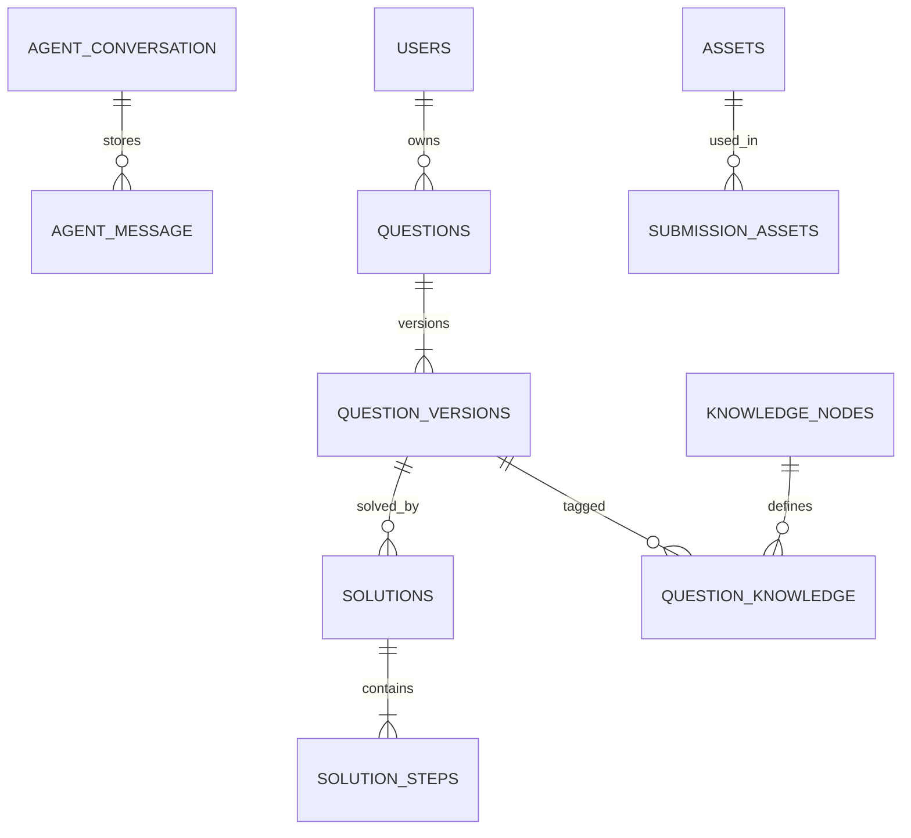

# 沐斯 AI 数字人教师数据库设计

## 2026-10-28：学生画像与长期记忆存储

L2 的 content 新增 keywords 字段作为 L1 内容的唯一来源。L1 由 extract_memory_index 工具确定性提取 L2.keywords，并复制 L2 的身份/月度/版本元数据、引用 L2 路径。存储层拒绝关键词或元数据与此投影不一致的 L1，三层继续按共同版本原子发布。旧 L2 兼容读取；可使用 cmd/student-memory-reindex 从旧 L2 结构化字段补齐关键词并重建 L1，保留原文及证据。

L0 存 MySQL；L1—L3 以完整路径作为 Redis String key，value 是 YAML，默认没有 TTL。月份依据原始学生输入时间转北京时间确定。

| 层 | key |
| --- | --- |
| L1 | /user/memory/indexes/学生_id/YYYY-MM.md |
| L2 | /user/memory/学生_id/YYYY-MM/meta.md |
| L3 | /user/memory/学生_id/YYYY-MM/content.md |

新增三张业务表，不修改四张 Agent Store 表的职责：

现有 education 库的 student_profile 使用 sid/subject/type/details 等旧字段，每学生可多行；新模块使用独立 student_profile_l0，不改写或自动导入旧表，避免将无来源旧判断当作新证据。

- student_profile_l0：自增 id、唯一 student_id、revision、basic_json、observations_json、updated_at。学生填写资料和模型待验证候选分开；基本资料更新使用乐观锁。
- student_memory_state：每学生的处理状态、写租约、下次重试时间、最近触发原因和最近成功时间。只保存稳定错误码，不保存包含原文或密钥的异常。
- student_memory_turn：唯一原始 assistant 消息引用、scope_key、student_id、月份、处理时间。它是可恢复来源进度，不另存原始对话全文。

建表脚本位于 internal/adapters/persistence/mysql/studentmemory/schema.sql，由 cmd/runtime-db 显式执行。L1/L2/L3 在 Redis 通过 Lua 比较旧值后同时发布，不产生新索引配旧原文的半更新状态。L3 只允许追加，禁止重写/删除已有轮次。Redis 发布成功后，L0 候选合并与进度确认在同一 MySQL 事务完成；跨库不宣称分布式事务，通过来源去重和重试补偿。

本机专用 Redis 监听 127.0.0.1:6380，数据目录 var/redis，启用 AOF everysec 与 noeviction；正式部署应使用受管 Redis 并配置备份。无 TTL 不等于数据永不丢失，持久化说明见 [Redis 官方文档](https://redis.io/docs/latest/management/persistence/)。Agent Store 的 MySQL 原始记录保持独立，不能为了压缩而删除。当前没有 Redis 全量丢失自动重建功能。

L0 自述薄弱点与模型候选不互相覆盖；模型候选包含科目/知识/能力分类、待验证状态、关注程度、最近出现时间和题目/消息证据。本次关注程度默认一般，未实现自动严重度评定或已掌握判定。

版本：v7.0（raw/canonical 双视图）；更新：2026-10-27。Agent Store 使用 agent_conversation、agent_message、agent_branch 三张基础表，另以 agent_memory_compact 保存压缩版本；业务题目/学生数据不属于 Agent Store。最新决定：问题直接保存为待回答 user，回答完成后再形成完整问答，不写 submissions。

> v8.0 当前交付（2026-10-27）：文字与拍照单题已接入网页。图片使用 Go MCP SDK 调用阿里云市场通用识别GPU，默认 Streamable HTTP，可配置 SSE。当前文件保存在本地私有目录，OSS 尚未接入。本章节覆盖下文历史方案中的实施状态，原有产品分期不变。
## v8.0 MCP OCR 交付

链路：网页上传 → 保存原图 → Agent Store 保留原始备注与图片引用 → 原有四节点图 → math-solve Skill → recognize_input_image → MCP OCR → 缓存 OCR → validate_solution → finalize_solution 事务入库 → 正式回执展示与历史修复。

真实联调：合成图片“解方程 2x+3=7，求x。”识别为“解方程2x+3=7，求x。”，经百炼解答和独立复核得到 x=2，原图/OCR路径及答案/解析/步骤均已保存。该样例不替代手写、复杂公式和数学质量评测。

一期只支持清晰完整、无需理解配图的单题；JPG/PNG/WebP，最大5MiB、4000万像素。不包含多题切分、图形理解、人工 OCR 修订。失败保留原图及待回答消息，无正式回执不宣称完成。

原四张Agent Store表与五张题目表保留；新增两张教学业务表，不写submissions。cmd/runtime-db显式迁移，已有数据不改写。

| 表 | 字段与约束 | 职责 |
|---|---|---|
| teaching_image_asset | id自增，asset_id唯一；student_id/object_key/sha256/mime/size_bytes/width/height/created_at；唯一(student_id,sha256) | 不可变原图及所属关系 |
| teaching_ocr_result | id自增，result_id唯一；asset_id外键/config_hash/status/lease_token/lease_until/result_json/created_at/updated_at；唯一(asset_id,config_hash) | NEW/PROCESSING/READY/FAILED及OCR缓存 |

result_json包含OCR原文、text_hash、image_hash、原图/OCR文件键、request_id、工具名及传输方式。config_hash含产品/工具/configure/解析版本，不含密钥URL。READY只读，更改配置产生独立缓存。

agent_message.ext增加ImageAssetID；可选image_asset_id进入QueryHash，空值omitempty保持文字请求哈希兼容；成功封口保留OriginalInput。teaching_question启用现有input_type、source_image_object_key、ocr_result_object_key；original_text为OCR原文，question_json为规范题干。答案、解析、步骤和回执仍在同一事务。

文件键：images/<学生哈希前缀>/<asset_id>.<ext>和ocr/<asset_id>/<原响应SHA256>.json；数据库保存相对键，不保存二进制。实际目录默认var/private-assets。文件和SQL不是跨系统原子事务：上传失败/去重清理本次新文件，崩溃可能留下无引用文件，目前尚无自动清理；生产需持久卷备份或私有OSS。

## 既有方案（历史实施状态以v8.0章节为准）


## 1. 存储决策

一期、二期使用 MySQL 作为业务权威库，结构化列＋版本化 JSON/TEXT 表达题目内容，私有 OSS 保存原图。暂不引入 MongoDB。三期增加可重建检索索引，引擎待评测选型，MySQL 继续保存审核题库事实。

JSON 可表达选项、小问、公式和扩展字段；频繁过滤、关联、唯一性和排序字段独立建列/索引。不因“AI 输出 JSON”直接拆双库。将权威内容拆至 MySQL/MongoDB 会增加跨库提交与恢复责任，当前没有该需求依据。

图片不以 BLOB 存数据库，不将临时签名 URL 当永久路径；保存 asset_id、object_key、内容哈希与所属关系。大 OCR 原响应/资料可归档 OSS，数据库保留引用和内容版本。

## 2. 通用约定与关联

- MySQL 8.0+、InnoDB、utf8mb4；具体云版本在部署评审确认，不借本稿自动升级现有实例。
- 新业务 ID 建议 CHAR(36) UUID；版本号/序号为正整数，时间 DATETIME(6) UTC。Runtime 的 CHAR(64) 哈希键保持既有实现，不为统一外观改其 DDL。
- 公式/原文保持 Unicode 原样，不自动大小写折叠、改比较符或数学数值。指纹规范化算法、Schema、知识体系均记录版本。
- JSON 校验 Schema 与业务规则；同一题有多个解析版本，原始提交、学生作答和 AI 解答分别建模。
- 业务查询必须限制当前学生/所属关系，UUID 不代替授权。当前阶段不共享不同学生的私人题目实体。
- 外键/唯一约束用于可表达的归属和引用，事务校验用于状态/当前版本等跨行规则；不得依赖 ORM 默认关联替代显式检查。



agent_message 在解题前保存待回答 user，完成回答后标记 SEALED；没有学生解答时不建非空 attempt。以下表为业务逻辑设计，未据此自动创建；Agent Store 及压缩表迁移见第 5 节。现有 education 库中的业务表保持原样。

## 3. 一期业务逻辑表

### 3.1 账号、资源与原始输入

| 表 | 主要字段/类型 | 约束与索引 |
|---|---|---|
| users | id CHAR(36)、login_name、password_hash、role、status、must_set_password、auth_version、created_at | login_name 唯一；角色/状态受控；密码不存明文 |
| activation_tokens | id、user_id、token_hash、expires_at、used_at | token_hash 唯一，一次性/可撤销；user_id 外键 |
| auth_sessions | id、user_id、token_hash、expires_at、auth_version | token_hash 唯一，过期/停用可失效 |
| assets | id、student_id、object_key、purpose、hash、mime、size、width/height、status、created_at、deleted_at | object_key 唯一；(student_id,status,created_at)；purpose 区分题目/错解 |
| message_assets | source_message_id、asset_id、purpose、ordinal | (source_message_id,purpose,ordinal) 唯一；每个引用同所有者，保留多资源顺序扩展 |
| ocr_results | id、asset_id、purpose、api_name、adapter/config_version、content_hash、raw_json/oss_ref、text TEXT、blocks JSON、provider_request_id、created_at | (asset_id,purpose,api_name,adapter_version,config_version,content_hash) 唯一；旧识别结果不覆盖 |
| attempts | id、source_message_id、student_id、question_version_id、raw_text TEXT NULL、submitted_at | source_message_id 唯一；有学生提交的文字/图片作答时建立，不能将 solution 当作答 |

姓名/年级是否激活时必填仍为需求待决策，不在 users 增加教学信息非空约束；二期通过学习信息表采集。assets 状态建议 CREATED/READY/DELETING/DELETED/FAILED，实际对象就绪后才允许绑定解题。

OCR 只做识别，不能将输出中的配图坐标当作图形事实。共享缓存可复用识别结果，但资源授权与来源绑定仍逐请求校验。

### 3.2 题目、解答与分类

| 表 | 主要字段/类型 | 约束与索引 |
|---|---|---|
| questions | id、student_id、question_no、current_question_version_id、current_solution_id NULL、fingerprint、normalizer_version、created_at、deleted_at | (student_id,question_no) 唯一；列表 (student_id,deleted_at,created_at,id)；当前指针须属于本题 |
| question_versions | id、question_id、version INT、question_type、stem_text TEXT、structure JSON、schema_version、source_message_id、created_at | (question_id,version) 唯一；发布后不可变；structure 含选项/小问/公式片段 |
| solutions | id、question_version_id、version INT、answer JSON、analysis TEXT、status、model_ref、prompt/schema_version、validation_ref、created_at | (question_version_id,version) 唯一；正式状态仅经冻结/事务提交；答案与小问对应 |
| solution_steps | id、solution_id、ordinal INT、subquestion_id NULL、title、content TEXT/JSON | (solution_id,ordinal) 唯一；id 是稳定 step_id；不得跨解答版本引用 |
| knowledge_nodes | id、outline_version、code、parent_id NULL、name、definition、active | (outline_version,code) 唯一；父子同版本、无循环 |
| question_knowledge | question_version_id、knowledge_id、role | 组合唯一；每个正式题目版本恰有一个 PRIMARY，其余 AUXILIARY |
| personal_categories | id、student_id、name、parent_id NULL | 归学生所有，与标准知识目录分开 |
| question_categories | question_id、category_id | 组合唯一；分类所属学生必须与题目相同 |

若未来校验需要每个解析版本自己的知识标签，扩展 solution_knowledge，不静默改写旧题目版本。平台标准知识标签和学生分类不可用同一字段覆盖。

同题判断先找学生范围内同指纹候选，再比较规范题干、选项/小问和条件。设计上可为活跃题定义生成列 active_fingerprint（未删除时取 normalizer_version＋fingerprint，否则 NULL）及 (student_id,active_fingerprint) 唯一索引，避免并发重复建题。不能直接用 (student_id,fingerprint,deleted_at) 依赖 NULL 表达唯一活跃题。

指纹发生碰撞但内容不同的情况显式报冲突并保留原 submission，不能当同题合并或丢弃输入。变式条件不同不合并；重新解题新增 solution，不因相同输入覆盖历史。

### 3.3 任务、候选与回执

| 表 | 主要字段/类型 | 约束与索引 |
|---|---|---|
| jobs | id、student_id、type、status、stage、payload/result JSON、priority、lease_token BIGINT、lease_until、worker_id、retry_count、next_run_at、error_code | (status,next_run_at,priority,id)、租约扫描；payload 保存不可变输入/版本引用 |
| idempotency_requests | student_id、operation、idempotency_key、request_hash、job_id/resource_id、created_at | (student_id,operation,idempotency_key) 唯一；同 key 不同正文返回冲突 |
| agent_drafts | id、run_id、job_id、student_id、mode、lease_token、source_versions JSON、payload JSON、payload_hash、validation_report JSON、expires_at、committed_result_id NULL | 不可变候选；仅当前绑定/租约可提交；修订创建新 draft |
| commit_receipts | id、job_id、namespace/subject/conversation/turn/run、input_version、result_type、result_id、terminal_observation JSON、protocol_tail_hash、committed_at | job_id 唯一；逻辑业务 turn 唯一；Run 重试不产生第二次正式提交；终结 Tool 的原 call_id/精确返回载荷与结果同事务冻结 |
| provider_call_slots | slot_id、owner、lease_token、lease_until | 原子抢占/释放、过期回收；用于待实现全局并发 |
| provider_calls | id、job/run_id、provider_request_id、model/API/config_ref、tokens、duration、status、created_at | job/run 与时间索引；不默认存完整学生正文 |
| audit_logs | id、actor_id、action、resource_ref、result、created_at | 审计归属与时间索引，不写密码/密钥 |

commit_receipts 是业务事实，Agent Store 仅保存关联及回执哈希，不单独建立 agent_runs 表。画像/解析等不同业务操作使用不同 operation/turn 坐标，避免错误共用幂等键。

## 4. 一期内容载荷与事务

### 4.1 结构示意

```json
{
  "schema_version": "question-v1",
  "question_type": "solution",
  "stem_text": "原样保留的规范题干与 LaTeX",
  "options": [],
  "subquestions": [{"id": "part-1", "ordinal": 1, "text": "小问原文"}],
  "formula_segments": [{"id": "formula-1", "latex": "x^2-1"}]
}
```

示例只说明形状，不是已发布 JSON Schema。答案在 solutions.answer 保存，解析与步骤分别保存；不要把模型原始 JSON 直接整体落成唯一“题目字段”。原始 OCR、题目规范表示、学生作答和标准答案各有来源/版本。

### 4.2 原子事务边界

| 用例 | 同事务写入 | 事务外动作 |
|---|---|---|
| 创建解题请求 | 原始 user 消息/资源引用、幂等请求、SOLVE job | 上传/OCR/模型执行 |
| 提交合格解答 | 题目/题目版本、解答/步骤、知识关联、原始消息/可选 attempt 关联、draft 提交、job 成功、回执、修复待办 | API 展示、Runtime 历史封口 |
| 删除私人题目 | 软删除、撤销绑定/待处理任务、建立 OSS/记忆清理 job；二期再加会话关闭/证据失效重算 | OSS 和 Runtime 物理清理 |
| 修复运行历史 | 校验已存在回执，写恢复进度/终态 | 不再次执行模型/正式工具 |

模型与网络不持有长事务。提交时检查所有者、当前 fencing、候选哈希/来源版本、题目未删及资源有效。建议锁序：job → draft → question → 二期 session → 二期 profile 项 → 资源引用；集合按稳定 ID 排序，实际未涉及表跳过。

候选结果/资源首次入库就考虑删除与权限；不是上线前才补状态。提交后运行轨迹失败不会把业务 job 从成功改回失败重跑，回执查询失败先对账。

## 5. Agent Store：三张消息基础表＋独立压缩表

参考《小荷 AI 医生 · IM 与 Agent Store 存储设计》：会话指针、按角色聚合的消息、分支元数据。原十表方案和代码已归档，不再是当前实现。

| 表 | 职责 | 不承载 |
|---|---|---|
| agent_conversation | 完整 Scope、当前分支/末梢/位置、version/epoch；当前执行租约元数据；当前摘要引用及覆盖证明；有限压缩任务状态和合并唤醒标记 | 全量 Run 历史、工具轨迹、模型请求快照、无限增长的任务日志 |
| agent_message | 待回答 user 与完整问答的 user/assistant；真实内容、状态、位置、版本、幂等及哈希 | 虚假 assistant、工具中间过程、系统提示词、供应商隐藏推理 |
| agent_branch | root/edit/regenerate 的父分支、完整轮次 fork 边界、父消息/位置和创建版本 | 复制祖先消息、独立执行日志 |

实际实现：`internal/adapters/persistence/mysql/agentstore/`。迁移：`migrations/003_three_tables.sql`。不增加 Run、Item、Snapshot、Event、SummaryJob 表；新增的 agent_memory_compact 仅负责压缩结果。

```sql
-- Three-table Agent Store. Run buffers and model snapshots are not SQL records.
CREATE TABLE IF NOT EXISTS agent_conversation (
 id BIGINT UNSIGNED NOT NULL AUTO_INCREMENT PRIMARY KEY,
 scope_key CHAR(64) CHARACTER SET ascii COLLATE ascii_bin NOT NULL,
 namespace VARCHAR(64) NOT NULL,
 subject_id VARCHAR(128) NOT NULL,
 conversation_id VARCHAR(128) NOT NULL,
 current_branch_id CHAR(36) CHARACTER SET ascii NOT NULL,
 current_message_id CHAR(36) CHARACTER SET ascii NULL,
 current_position BIGINT UNSIGNED NOT NULL DEFAULT 0,
 version BIGINT UNSIGNED NOT NULL DEFAULT 0,
 history_epoch BIGINT UNSIGNED NOT NULL DEFAULT 1,
 active_run_id VARCHAR(128) CHARACTER SET ascii NULL,
 status VARCHAR(24) NOT NULL DEFAULT 'ACTIVE',
 memory_due_at DATETIME(6) NULL,
 event_due_at DATETIME(6) NULL,
 ext JSON NOT NULL,
 created_at DATETIME(6) NOT NULL,
 updated_at DATETIME(6) NOT NULL,
 creation_request_id VARCHAR(128) CHARACTER SET ascii COLLATE ascii_bin NULL,
 UNIQUE KEY uk_scope_key(scope_key),
 UNIQUE KEY uk_conversation_create(namespace,subject_id,creation_request_id),
 UNIQUE KEY uk_scope(namespace,subject_id,conversation_id),
 KEY idx_memory_due(memory_due_at,scope_key),
 KEY idx_event_due(event_due_at,scope_key)
) ENGINE=InnoDB DEFAULT CHARSET=utf8mb4 COLLATE=utf8mb4_bin;

CREATE TABLE IF NOT EXISTS agent_message (
 id BIGINT UNSIGNED NOT NULL AUTO_INCREMENT PRIMARY KEY,
 scope_key CHAR(64) CHARACTER SET ascii COLLATE ascii_bin NOT NULL,
 message_id CHAR(36) CHARACTER SET ascii NOT NULL,
 branch_id CHAR(36) CHARACTER SET ascii NOT NULL,
 parent_message_id CHAR(36) CHARACTER SET ascii NULL,
 position BIGINT UNSIGNED NULL,
 version BIGINT UNSIGNED NOT NULL,
 role VARCHAR(16) CHARACTER SET ascii NOT NULL,
 status VARCHAR(24) CHARACTER SET ascii NOT NULL DEFAULT 'SEALED',
 subject_scope CHAR(64) CHARACTER SET ascii COLLATE ascii_bin NULL,
 client_request_id VARCHAR(128) CHARACTER SET ascii COLLATE ascii_bin NULL,
 content JSON NOT NULL,
 ext JSON NOT NULL,
 turn_id VARCHAR(128) CHARACTER SET ascii NOT NULL,
 run_id VARCHAR(128) CHARACTER SET ascii NOT NULL,
 turn_cursor BIGINT UNSIGNED NOT NULL,
 content_hash CHAR(64) CHARACTER SET ascii NOT NULL,
 prefix_hash CHAR(64) CHARACTER SET ascii NOT NULL,
 created_at DATETIME(6) NOT NULL,
 UNIQUE KEY uk_scope_message(scope_key,message_id),
 UNIQUE KEY uk_position(scope_key,branch_id,position),
 UNIQUE KEY uk_turn_role(scope_key,turn_id,role),
 UNIQUE KEY uk_query_request(subject_scope,client_request_id),
 KEY idx_query_recent(subject_scope,created_at,message_id),
 KEY idx_branch_version(scope_key,branch_id,version),
 KEY idx_turn_cursor(scope_key,turn_cursor,role),
 KEY idx_run(scope_key,run_id)
) ENGINE=InnoDB DEFAULT CHARSET=utf8mb4 COLLATE=utf8mb4_bin;

CREATE TABLE IF NOT EXISTS agent_branch (
 id BIGINT UNSIGNED NOT NULL AUTO_INCREMENT PRIMARY KEY,
 scope_key CHAR(64) CHARACTER SET ascii COLLATE ascii_bin NOT NULL,
 branch_id CHAR(36) CHARACTER SET ascii NOT NULL,
 parent_branch_id CHAR(36) CHARACTER SET ascii NULL,
 fork_parent_message_id CHAR(36) CHARACTER SET ascii NULL,
 fork_parent_position BIGINT UNSIGNED NULL,
 fork_parent_version BIGINT UNSIGNED NULL,
 last_position BIGINT UNSIGNED NOT NULL DEFAULT 0,
 created_version BIGINT UNSIGNED NOT NULL,
 op VARCHAR(24) CHARACTER SET ascii NOT NULL,
 created_at DATETIME(6) NOT NULL,
 UNIQUE KEY uk_scope_branch(scope_key,branch_id),
 KEY idx_parent(scope_key,parent_branch_id)
) ENGINE=InnoDB DEFAULT CHARSET=utf8mb4 COLLATE=utf8mb4_bin;
```

### 5.1 字段及数据载荷

- scope_key 由 Namespace/SubjectID/ConversationID 确定，业务层校验身份和资源权限；全部读写带完整 Scope。
- content 是唯一模型消息内容字段，结构为 `{ "items": [Eino 原生消息...] }`。user 仅含原始本轮输入；assistant 按顺序聚合本轮 assistant/tool 消息。ContextBuilder 读取时再展开，保持 tool_call_id 配对。
- message.ext 保存 Input 引用、InputHash、ReceiptHash、MessagesHash，仅用于幂等与关联，不复制模型消息内容或执行轨迹。
- turn_id/run_id/turn_cursor 保留为运行及业务关联字段，不对应独立数据库表。位置 position 属于 branch，turn_cursor 属于会话成功/尝试序号，两者不能混用；失败允许序号空洞。
- conversation.ext 是有界当前状态：Active 为当前 Input/租约/策略，LastAttempt 为最近一次绑定元数据，Summary 为当前摘要，SummaryToken/SummaryThrough 为覆盖证明，Jobs 至多 8 条压缩描述，Event 为 1 条合并唤醒。不会把旧十表历史全部塞进 ext。
- 当前摘要只保留有效最新版本；分支切换清空摘要，旧任务按 epoch 标记过期，不保留独立摘要版本表。

## 6. 写入与失败策略

1. Begin 建立 root（若不存在），锁定会话并检查活动运行、绑定和 fencing token；运行控制元数据可持久化。
2. SaveSnapshot / Append 只写进程内 buffer。模型请求、工具调用/结果不会形成数据库中间记录；进程退出即丢失。
3. 正式终结工具先完成业务事务。事务保存结果、完成回执、精确工具返回和必要的原始恢复前缀；业务事实不由 Agent Store 代替。
4. Finish 成功时，在一个 MySQL 事务写入完整 user＋assistant；如 user 已以 RECEIVED 保存，复用并封口，不重复插入，更新分支 last_position、会话 head/version，以及会话内合并唤醒标记。任何写入失败则本次封口整体回滚；此前已接收的 user 仍然保留。
5. 未提交业务的失败执行不写 assistant 或中间轨迹，丢弃内存 buffer；此前接收的 user 问题仍保留 RECEIVED，便于重试。
6. 业务已提交而消息写入失败：返回 pending_repair，不再运行 Agent。RepairFromStore 优先使用当前进程 buffer 或已成功消息；重启后需要完成回执 FrozenPrefix＋TerminalObservation 补写原协议。缺少完整早期工具结果则保持待修复，不编造，不重复提交。

这里的“失败无消息记录”不意味着删除会话/root 或取消 fencing，也不承诺工具副作用自动回滚。工具及业务提交必须幂等。正常业务提交和消息发布仍是两个事务，二者之间的修复待办由业务模块实现。

## 7. 查询、分支与记忆

### 7.1 查询和分支

- ReadHead 返回 Scope/branch/tip/version/epoch；LoadPage 每页 1—100 个完整 Turn，按索引范围加载，不用 OFFSET。
- 先加载祖先分支在 fork 点以前的片段，再加载子分支自身片段；不能用祖先 position 直接过滤子分支。
- 固定 Token 允许后续追加，但分页不会混入追加内容。分支切换和删除使旧 Token 失效。
- Fork 仅是 Go 基础设施 API，必须在完整 Turn 边界、无活动运行、预期 Token 相符时调用；学生端编辑/重试入口仍待产品实现。技术重试不创建分支。
- 位置采用分支内单调整数；当前只追加，不实现参考文档的 fractional position / InsertAfter / parent splice。摘要存会话 Memory，不作为 assistant 消息插入链中，因此一期没有中间插入需求。未来若新增需求再独立迁移，不能假称当前支持 fractional。

### 7.2 异步压缩

- 继承已确认策略：后台异步压缩；摘要未就绪且上下文超预算时返回可重试错误，不在请求中等待摘要。
- 默认阈值为输入可用预算的 70%，保留最近 4 个完整轮次，摘要最多 2048 预算单位。当前计数器为保守估算，可替换实际 tokenizer。
- 当前摘要及 branch/epoch/覆盖消息/prefix_hash 保存在 conversation.ext。ContextView 验证覆盖证明后只读未覆盖片段；原消息不删除。
- 不建摘要任务表：Jobs 是每会话最多 8 条有界状态描述，保留 retry/lease/claim token/base revision，终态在下一次调度清理。超上限显式返回错误供调度重试，不静默丢弃。
- memory_due_at 索引支持 Worker 扫描；领取只在短事务中锁会话，模型调用在事务外。相同会话的元数据操作串行；这不是通用分布式队列。
- 不建 outbox 表：一次成功封口更新该会话的合并唤醒标记；多次封口可合并，调度读取最新完整历史。Ack/Defer 必须比较原事件 ID，不能清掉后来产生的新标记。
- 发布摘要检查 lease/claim、base revision、branch/epoch 和覆盖前缀。错误/过期结果不覆盖当前摘要。Summary ModelRef 随任务固定，不同模型配置的 Worker 不接续生成。

## 8. 删除、迁移与上线边界

Forget 删除该 Scope 的消息和分支，清除当前记忆/任务/唤醒，保留无题目正文的会话墓碑并递增 epoch。业务层先撤销绑定、停止任务；旧请求不能重新创建同一 Scope。业务表和 OSS 资源由业务模块按权限删除。

本机 education 库此前新增的十张 agent_store_ 表经逐表 COUNT 确认为空；本次创建三表并显式移除这十张空表。原五张 history、question_basic_info、question_type、student_info、student_profile_l0 保持原样。旧 DDL/Go 实现保存在 `_archive/2026-10-26/`，旧技术文档保存在 `docs/archive/2026-10-26/`。

正常命令 `go run ./cmd/runtime-db` 仅显式创建/校验三表，不自动清理旧表。维护命令 `-retire-empty-v2` 在停止旧写端后使用，任何旧表非空则拒绝整个清理；它不做数据迁移，不改业务表。MySQL DDL 不是完整事务，部分失败可重试。已有旧历史如需保留，应另行设计转换、核对和切换，不能强删。

三表只解决 Agent 历史/分支/当前记忆；账号、正式题目结果、业务回执事务、HTTP、OCR/OSS、画像与 RAG 仍按三期业务计划交付。二/三期业务逻辑表见需求和后续业务迁移，不能混同为 Agent Store 附属表。

## 9. 验收与验证记录（2026-10-26）

专项 MySQL 集成测试使用独立随机测试库，验证仅三张表、整轮成功两块消息、失败中间过程不落库、Scope 隔离、幂等/fencing、完整轮次分页、分支/摘要覆盖、异步任务并发领取、合并通知不漏新封口、墓碑、重启后凭业务回执补写且不重跑工具，以及拒绝删除非空旧表。

这些验证说明存储与 Runtime 协议行为，不代替真实云模型数学质量、生产容量或尚未实现的正式业务事务验收。


## 10. 当前网页直存规则与已验证结果

- 前端改为 POST /api/v1/messages；GET 详情和列表都直接读取 agent_message。submissions 不再作为任何当前请求的读写路径，其旧适配器归档。
- NewQueries 默认 namespace=teacher，学生身份来自服务端。首次保存原子创建/复用会话和根分支，写一个 user；一条输入不是三份内容，三表分别负责会话、关系和消息。
- user.content.items 保存原文；status=RECEIVED、position=NULL、version=0、turn_cursor=0 表示已接收但未回答，不进入 ContextView 的完整问答。对当前完整会话指针/version 无影响。
- subject_scope 是 namespace/学生哈希；(subject_scope,client_request_id) 唯一，保证跨会话复用同请求编号也不能插入不同内容。ext.QueryHash 校验原始 query/会话/请求编号。
- 后续 Begin 绑定原 user 的 message_id，开始处理时分配 turn_cursor。成功 Finish 检查原文一致，更新原 user 的 parent/position/version/run/cursor/status，新增真实 assistant；原文与 message_id 保持不变。失败不删除已接收输入。
- 页面回读状态为 RECEIVED 或 ANSWERED；数据库中完整 user/assistant 都是 SEALED。列表按原始接收时间/message_id 翻页；模型历史只按完整链读取。
- 现有数据库由 upgrade.go 幂等升级：增加状态/请求唯一键，允许未封口位置为 NULL，已有完整记录按 SEALED 保留。Agent Store 仍只三表。
- 此前 submissions 两条记录已保留原文、学生、会话、请求编号和原始时间导入 Agent Store；旧表保持原样，无新增写入。正常入口不创建/使用旧表，不自动删除历史。

已验证真实网页新会话提交同时存在 conversation、ROOT branch、user/RECEIVED，未生成 assistant；旧 submissions 行数保持 2。专项测试覆盖并发/幂等/归属/分页、待回答消息不混入模型历史、失败保留问题、回答复用原 user、原文篡改拒绝及升级后旧历史一致。

当前 Memory 仍按历史估算预算 70% 触发，至少有超过 4 个未覆盖完整轮次，最近 4 轮保留原文；异步摘要最多 2048 预算单位。最新摘要保存于 conversation.ext.Summary，覆盖证明为 SummaryToken/SummaryThrough；RECEIVED 问题不触发摘要，也不是学生掌握证据。


## 11. 上下文标签与摘要 JSON 的存储边界

identity/skill-reminder/user-memory-reminder 固定 SP 保存在可编辑 Markdown 文件，技能目录按只读 SKILL.md 元数据生成；system/preamble/memory 不写进 agent_message。student-input 与当前题目/约束前缀作为 canonical user 保存，学生原文保存在 ext.OriginalInput 供网页回读。

当前摘要增加 Summary.Structured（math-summary-v1）：overview 和带 source_turn_ids 的 student_statements/teaching_actions/pending_questions/uncertainties。Summary.Content 兼容保留 overview；Revision/ThroughCursor/SourceHash、SummaryToken/SummaryThrough 继续维护覆盖证明。JSON 字段增量兼容旧数据，无需新增表或列。

长期记忆以 Binding.LongTermMemory 的授权 JSON 对象注入，尚未实现新的跨会话画像读写流程；没有数据为空对象。当前题目使用 Binding.Blocks 中的 current-problem，缺省省略对应上下文块。Snapshot 的 OriginalInput 和 BlockHashes 仅为运行内存状态，不新增请求快照表。


## Runtime v4.0：原始输入、canonical 历史与事件

本次不增加表或修改列结构。执行前 Runtime.PersistUser 与网页 query 复用同一待回答 user；此前没有记录的内部输入也会在模型执行前保存 RECEIVED user。失败只保留已接收原文。

封口时先核对原始 pending 内容与 Snapshot.OriginalInput，再把加入当前题目/约束前缀的 canonical user 更新到同一 content.items；同步重算 content_hash/prefix_hash，保留 message_id、接收时间和请求幂等键，ext.OriginalInput 保留原始 schema.Message。GET/列表优先从 ext.OriginalInput 取学生原文；历史分页读取 canonical content，避免下轮上下文与上轮模型实际输入不一致。

preamble 和 memory 是模型上下文，不作为 agent_message 写入；可快照到 TurnCompleted。聚合 assistant 中每个 tool_call/tool_result 保留原生协议，多个语义 item 共享所属物理 message_id/position，以事件 Index 表达块内顺序；TailSeq 为分支末位置。

Storage CRUD 与 runtime/storage/inject.go 分离。Finish 成功后才发送外部 Producer；发送失败只告警。现有 conversation.ext.Event 是有界合并的本地压缩唤醒，不是完整事件日志或通用可靠总线；默认外部 Producer 为 noop。压缩写侧迁到引擎外 internal/agent/memory，仍复用三表中的摘要和有界任务状态。


## v5.0：四节点链路的存储兼容（2026-10-27）

本次无 DDL 变更，Agent Store 仍只有三表。新 HTTP 入口使用同一 query 请求唯一键与原始 user，Registry/Graph/Trace 不增加数据库表。query 回读增加 turn_id 字段以绑定服务端运行坐标。

普通对话采用 Kind=engine 的执行完成记录，仅表示消息已封口，不代表 question/solution 业务提交；正式教学仍采用业务回执策略。两种策略均复用原 Finish 原子事务、分支/游标/fencing 和 raw/canonical 双视图。成功重试点查 GetTurn 回放已有回答，不再次调用模型。

Summary.Structured 的 Go 类型改为 json.RawMessage，数据库仍为相同 JSON 对象；math-summary-v1 字段移入教学业务模块，旧摘要无需迁移。Runtime 不解析学生陈述或教学证据，后台教学 Memory 管线继续校验来源。

TurnCompleted 的 completed/failed 统一契约不意味着新增事件表。后台 DispatchOne 从已有有界唤醒重建完整事件后交给 Consume；封口后事件发送失败不反转提交。Trace 默认走独立日志 exporter，未把题目正文或跨度日志写入三表。


## 本次更新：独立记忆压缩存储（2026-10-27）

长期记忆暂不实现。本次仅处理会话历史摘要，不从摘要推断学生已掌握知识或长期能力。

- 三张基础表继续承载会话、原始问答和分支；`agent_memory_compact` 保存每次成功压缩的结构化内容，旧版本保留。`agent_conversation.ext.Summary` 只保存当前引用与覆盖元数据，不重复存正文。
- 解题与压缩均使用 `BAILIAN_CHAT_MODEL` 指定的同一百炼模型，服务启动后自动运行后台压缩。独立 Worker 也使用该变量，无需配置单独摘要模型。
- 默认应用上下文预算 16384、输出预留 4096，可用输入预算 12288；80% 向上取整为 9831。成功轮结束后优先采用供应商返回的完整请求输入 token 数（包含 SP、工具和上下文），没有供应商用量时使用保守估算，查询结果明确标注来源。
- 未覆盖历史超过 4 个完整问答轮次才有可压缩内容；保留最近 4 轮，压缩更早前缀。不是每 N 轮定期提取。摘要输出上限 2048 token，优先按供应商用量校验；无用量则用保守估算。
- 装配前的安全检查仍使用保守 UTF-8 字节估算，并非精确 tokenizer，因此可能在供应商真实输入达到 80% 之前触发强制压缩。当前请求不等待；返回可重试错误。只剩保留轮次或单轮过大时可能没有可压缩前缀，重试本身不能解决这类超限。
- 压缩模型调用在事务外；发布时在同一事务内新增压缩版本、校验分支/epoch/来源前缀/旧摘要 revision/任务租约并更新会话引用。过期结果不发布，失败按有界重试保留旧有效摘要。
- 压缩不更新或删除 `agent_message` 原始内容和哈希。下一轮仅以“摘要＋未覆盖完整问答”装配模型上下文。显式遗忘/删除是另一条数据清理流程。

### 验证接口

`GET /api/v1/conversations/{conversation_id}/messages?limit=100`

返回全部角色的存储消息，包含待回答输入和非当前分支；每页 1—100 条，通过 `next_cursor` 继续读取全部记录。学生身份由服务端绑定，不能通过参数访问其他学生。

| 字段 | 含义 |
|---|---|
| messages | 原始存储消息的 ID、角色、状态、分支、轮次、content.items、original_input、内容/前缀哈希、时间 |
| messages[].in_active_chain | 是否属于当前模型使用的分支链 |
| messages[].covered_by_current_compact | 是否被当前有效摘要覆盖；true 的原消息仍完整返回 |
| total_messages / next_cursor | 总消息数和后续页游标 |
| current_summary | 当前生效摘要、压缩 ID、revision、覆盖游标和模型 |
| recent_compacts / compact_versions | 最近 20 个压缩版本及全部版本数量；数据库保留全部版本 |
| last_model_usage | 最近成功轮模型输入/输出用量，source 区分 provider 与 estimate |
| policy / trigger_tokens | 当前默认配置与 9831 的触发阈值 |

分页期间消息集合、分支或摘要版本变化时返回 409，调用方重新从第一页读取，避免混合不同快照。原 `GET /api/v1/messages` 为输入记录列表，不用于验证完整对话。

### 部署与验收顺序

先显式运行 `go run ./cmd/runtime-db` 应用 004 迁移（003 基础表不变），再启动新版服务。已有会话内联摘要会迁移到独立表，原始消息不改；迁移可重复执行。不要让旧版写入端与新版压缩发布并行使用同一会话。

依次验证 80% 边界、结构化摘要及来源校验、两版摘要累计、原始消息内容/哈希不变、最近 4 轮上下文、完整消息分页、学生隔离，再验证真实百炼生成。强制压缩联调与 80% 自动触发测试分别记录，不把强制联调描述为真实用量达到阈值。

### agent_memory_compact 物理表

独立记录 scope、branch、history_epoch、revision，唯一键防止同一上下文发布两个相同版本。content 为结构化摘要正文；summary_json 为 Runtime 序列化记录；source_token 与覆盖前缀证明用于追溯，policy_json 固化当次策略。关联通过 scope_key 校验；不级联修改原始消息。

```sql
-- Append-only compaction versions; raw messages are never updated by compression.
CREATE TABLE IF NOT EXISTS agent_memory_compact (
 id BIGINT UNSIGNED NOT NULL AUTO_INCREMENT PRIMARY KEY,
 compact_id CHAR(64) CHARACTER SET ascii COLLATE ascii_bin NOT NULL UNIQUE,
 scope_key CHAR(64) CHARACTER SET ascii COLLATE ascii_bin NOT NULL,
 branch_id CHAR(36) CHARACTER SET ascii NOT NULL,
 history_epoch BIGINT UNSIGNED NOT NULL,
 revision BIGINT UNSIGNED NOT NULL,
 through_turn_cursor BIGINT UNSIGNED NOT NULL,
 through_message_id CHAR(36) CHARACTER SET ascii NOT NULL,
 through_position BIGINT UNSIGNED NOT NULL,
 through_prefix_hash CHAR(64) CHARACTER SET ascii NOT NULL,
 content JSON NOT NULL,
 overview MEDIUMTEXT NOT NULL,
 summary_json JSON NOT NULL,
 source_token JSON NOT NULL,
 policy_json JSON NOT NULL,
 model_ref VARCHAR(255) NOT NULL,
 source_hash CHAR(64) CHARACTER SET ascii NOT NULL,
 created_at DATETIME(6) NOT NULL,
 UNIQUE KEY uk_compact_revision(scope_key,branch_id,history_epoch,revision),
 KEY idx_compact_history(scope_key,created_at,compact_id)
) ENGINE=InnoDB DEFAULT CHARSET=utf8mb4 COLLATE=utf8mb4_bin;

```


## 标识治理：自增主键与业务发号（2026-10-27）

四张表统一使用 `id BIGINT UNSIGNED AUTO_INCREMENT PRIMARY KEY` 作为内部行主键。`scope_key` 保留完整 `(namespace, subject_id, conversation_id)` 的隔离哈希语义，不改成自增数，不接受客户端直接传入。自增 id 只负责数据库行定位，不代替消息链位置、业务 ID、授权或幂等键。

| 字段 | 新数据规则 | 兼容规则 |
|---|---|---|
| id | 每张表独立自增；仅在该表内有意义，允许空洞 | 005 迁移为已有行补齐，后续迁移不重新编号 |
| conversation_id | 服务端 UUIDv7，`c_`＋32 位十六进制字符串，34 字符 | 已存在的会话号继续有效；普通消息接口不再按客户端自定义编号创建新会话 |
| branch_id | 服务端 UUIDv7，`b_`＋32 位十六进制字符串，34 字符 | 旧 ROOT 哈希/分支 UUID 不改写；已存在会话始终复用其实际当前分支 |
| turn_id | 接受新问题时发出 `t_`＋32 位 UUIDv7；幂等命中时直接复用 | 旧轮次号及其派生消息映射保持兼容 |
| message_id | 同一个服务端轮次号派生 `mu_`/`ma_` 两个消息 ID，35 字符 | 旧轮次沿用旧哈希映射，既有消息 ID、父引用和前缀哈希不改写 |
| client_request_id | 客户端请求幂等键，可继续使用 UUID；重试不更换 | 不与 message_id 或 conversation_id 混用 |
| compact_id | 本次不变，继续按压缩来源/版本生成内容关联哈希 | 独立的自增 id 不改变压缩版本和引用 |

统一发号实现为 `internal/platform/idgen`，复用当前依赖的 UUIDv7 实现，不引入新的发号表或外部服务。类型前缀方便识别；时间段有序，同进程同类型连续发号单调递增，多进程之间不保证严格全局顺序。业务时间查询使用 created_at，消息因果顺序使用 branch/position/parent_message_id，不能按业务 ID 代替。UUID 只是标识，不是权限凭证。

一轮成功问答仍只有两条物理消息。两条消息使用同一个已发出的轮次号，分别加 mu/ma 前缀，是为了在模型执行前预知身份，同时让重复提交、消息事件、展示投影和最终落库得到相同 ID。共享映射由 `state.MessageID` 实现；不在发送事件时重新随机发号。mu/ma 内的时间表示该轮的发号时间，并非助手完成时间。

### 创建与提交顺序

1. `POST /api/v1/conversations`，JSON 为 `{ "client_request_id": "本次创建会话的请求键" }`。返回服务端生成的 conversation_id、branch_id。
2. 创建请求的唯一约束为 `(namespace, subject_id, creation_request_id)`；同一学生重试复用同一会话。不同学生的相同请求键互不影响。会话和 ROOT 分支在一个事务提交。
3. 使用返回的 conversation_id 调用原有 `/api/v1/messages` 或 `/api/v1/agentic/chat`。未创建的会话返回 404，不能从消息入口绕过发号；已存在旧格式会话继续可用。
4. 消息使用原有 `(subject_scope, client_request_id)` 唯一约束幂等；命中时返回原 turn_id/message_id，不能重新发号。成功封口、SSE 投影与 TurnCompleted 事件统一引用同一套消息 ID。

网页新建对话先使用本地草稿标识，第一次发送前向服务端创建正式会话；草稿标识只用作会话创建的幂等请求键。丢失创建回执时重试仍取回同一正式会话。已有本地会话继续使用旧 ID，消息的本地 UI 标识与 client_request_id 不充当数据库 message_id。

### 迁移及实现顺序

先应用 003/004 基础迁移，再通过显式 `cmd/runtime-db` 应用 `005_identifiers.sql`。005 将原主键转换为唯一键，增加自增主键；保留 scope_key、消息/分支组合唯一约束、内容和哈希。MySQL DDL 不属于普通业务事务，逐表检查可重复执行；失败时修复后继续，不删除或重建旧数据。

落地顺序：自增主键迁移 → 统一发号器与旧号兼容映射 → 服务端会话创建及幂等 → 网页草稿转正式会话 → 消息/事件/分支联动 → 并发与迁移回归。迁移不重写任何历史业务 ID，不通过更新旧消息来统一外观。

### 005 增量迁移原文

```sql
-- Add surrogate keys; preserve every existing business identifier and scope.
ALTER TABLE agent_conversation ADD COLUMN id BIGINT UNSIGNED NOT NULL AUTO_INCREMENT FIRST, DROP PRIMARY KEY, ADD PRIMARY KEY(id), ADD UNIQUE KEY uk_scope_key(scope_key), ADD COLUMN creation_request_id VARCHAR(128) CHARACTER SET ascii COLLATE ascii_bin NULL, ADD UNIQUE KEY uk_conversation_create(namespace,subject_id,creation_request_id);
ALTER TABLE agent_message ADD COLUMN id BIGINT UNSIGNED NOT NULL AUTO_INCREMENT FIRST, DROP PRIMARY KEY, ADD PRIMARY KEY(id), ADD UNIQUE KEY uk_scope_message(scope_key,message_id);
ALTER TABLE agent_branch ADD COLUMN id BIGINT UNSIGNED NOT NULL AUTO_INCREMENT FIRST, DROP PRIMARY KEY, ADD PRIMARY KEY(id), ADD UNIQUE KEY uk_scope_branch(scope_key,branch_id);
ALTER TABLE agent_memory_compact ADD COLUMN id BIGINT UNSIGNED NOT NULL AUTO_INCREMENT FIRST, DROP PRIMARY KEY, ADD PRIMARY KEY(id), ADD UNIQUE KEY uk_compact_id(compact_id);

```


## 题目入库粒度与 Agent Store 边界（下一步设计）

此次没有创建数学业务表。现场 schema 核查确认旧 question_basic_info 仅包含 qid/questionText/path 等旧字段，缺少正式答案、解析与步骤版本；旧五张业务表及遗留 submissions 均未被本次功能改写。当前写入入口不使用 submissions。新增业务表应通过独立迁移，不将旧 qid/字段直接改名以免破坏原业务。

建议沿用第 3/4 节的 questions、question_versions、solutions、solution_steps、assets、ocr_results、agent_drafts、jobs、commit_receipts 逻辑表，先完成文字路径，再补齐图片和 OCR。四张 Agent Store 表只承担会话、消息、分支及记忆压缩；题目实体以 source_message_id/source_turn_id/scope_key 关联对话。

后续新业务表采用 id 自增主键＋question_id/solution_id/step_id 等 UUIDv7 业务标识，保留旧数据的 qid 映射；旧文档中业务 id CHAR(36) 的示意是逻辑标识，不能照搬为与本次主键治理冲突的 DDL。正式迁移前需要给出现有学生 sid 与服务端 subject_id 的授权映射。

题目版本至少保存 original_text（文字原输入或图片 OCR 原始转录）、stem（规范题干）、input_type、source_message_id、source_hash、asset_id/ocr_result_id 与 source_version。原图 object_key 与 OCR 原响应 raw_result_object_key 分别由 assets/ocr_results 保存；OCR text 单独存数据库。图片不是只有一个混合 path，路径也不由模型候选填写。

solutions 保存 answer JSON（可按小问）、analysis TEXT 和固定题目版本；solution_steps 保存 step_id、solution_id、ordinal、title、content、subquestion_id，(solution_id,ordinal) 唯一且序号连续。校验后的草稿冻结 payload_hash/source_version，finalize_solution 只接 draft_id，在同一事务写正式业务结果、来源、全部步骤、回执和修复状态。原文错误不能由摘要或模型自由补写。

只有业务提交回执存在才显示题目“已保存”。Agent Store assistant SEALED 只表示某轮问答完成，不能代替解题业务事务状态。业务与历史封口之间使用持久回执和修复，不把两次提交称为一个原子事务。字段映射、工具契约、Hook 失败语义与来源粒度见《技术方案》的“数学单题结构化入库闭环”。

会话查询接口新增 active_chain_messages、compacted_messages、context_messages 三个跨分页统计字段；都在同一快照下按实际当前链计算，不修改任何消息内容。


## v7.0 文字解题实际物理表

在 education 库新增五张 teaching_ 业务表，四张 Agent Store 表及旧业务表继续保留。没有向 submissions 写入。新表以独立前缀避免与旧 question_basic_info/sid/qid 混用；当前绑定本地试点 subject，不宣称已经完成旧账号系统整合。

| 实际表 | 关键存储字段 |
|---|---|
| teaching_question | 自增 id、question_id、student_id、scope_key/turn_id、source_message_id、original_text、source_hash、input_type、规范 question_json、created_at；图片/OCR object_key 暂为 NULL |
| teaching_solution | 自增 id、solution_id、question_id、answer JSON、analysis MEDIUMTEXT、knowledge_points JSON、model_ref、review_status、schema_version |
| teaching_solution_step | 自增 id、step_id、solution_id、ordinal、subquestion_id、title、content；(solution_id,ordinal) 唯一 |
| teaching_solution_draft | 自增 id、draft_id、scope/turn/run/lease、source_hash、payload JSON、payload_hash、review_json、expires_at；内容创建后不可由模型更新 |
| teaching_solution_receipt | 自增 id、result_id、scope/turn、student_id、question_id/solution_id、input_json、receipt_json、view_json、history_status、repair_attempts/repair_due_at |

本版每个解题逻辑请求形成一个不可变题目与一个解答，schema_version 为 math-solution-v1；题目及解答的多版本编辑暂未开放，未创建 question_versions 表。不同新请求的相同题目暂不自动合并；同一请求键/turn 严格幂等。来源原文、答案、解析和逐步内容均有独立物理字段，不只存一个聊天 JSON；view_json 是同事务生成的正式展示快照。

外键保证解答属于题目、步骤属于解答；唯一键 uk_question_turn/uk_receipt_turn 保证一轮一个正式结果。业务写入与回执一次事务提交，Agent Store 封口是后续阶段；history_status 区分 PENDING/SEALED。

实际迁移在 internal/adapters/persistence/mysql/teaching/schema.sql，由 go run ./cmd/runtime-db 显式执行，HTTP 启动只验证表存在，不自动改表。原图与 OCR 列预留 NULL，不代表图片服务已实现。照片阶段需另建授权资产/OCR 来源记录，不允许模型自报路径。

## 解题 SSE 流式交付（2026-10-27）

网页使用 POST /api/v1/solve，提交原有JSON并设置 Accept: text/event-stream。未设置该Accept时保留原JSON响应，便于既有调用方兼容。请求格式/归属等前置错误仍以HTTP JSON返回；开始流后使用error和done事件表示失败。

事件：accepted（原始消息已保存）、progress（准备/识别/生成/校验/保存）、text_delta（模型公开文字增量）、draft_reset（开始新候选）、draft（答案/解析/步骤的待校验增量快照）、ocr（识别原文）、validation（是否通过及问题）、solution（数据库正式回执）、error、done。另每8秒发送heartbeat。event id只用于本连接顺序，不支持Last-Event-ID续传；断线后使用同一client_request_id重试，先读回执，已有结果不重跑模型或OCR。

主模型实际调用供应商Stream，边接收边投影，完整拼接schema.Message后再交给既有Eino ReAct同步Loop，所以四节点图和工具执行协议不变。只投影公开Content以及validate_solution候选中的answer/analysis/steps，不投影ReasoningContent、原始工具JSON、系统提示、密钥或独立复核器输出。每次生成受响应大小限制，增量草稿仅用于展示，不进入草稿校验/数据库保存逻辑；完整JSON仍须经既有严格校验及事务提交。

页面将流式内容标记为“待校验，尚未正式入库”，只有收到committed=true正式回执才显示已保存。校验修订会替换当前候选；失败保留原图、原始消息、OCR和公开反馈。OCR公式缺损应重传清晰完整题目或改用文字，不将重复解题视为重新OCR。

SSE写入带锁，防止心跳与模型分片交错；刷新失败取消执行；每次写入有15秒期限。请求预算与原185秒范围一致，客户端总等待210秒。流中断在提交前不生成正式题目，提交后仍以回执修复并幂等重放。
